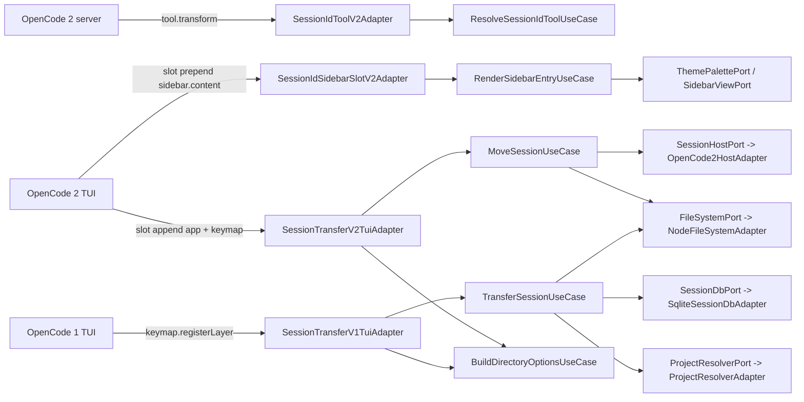
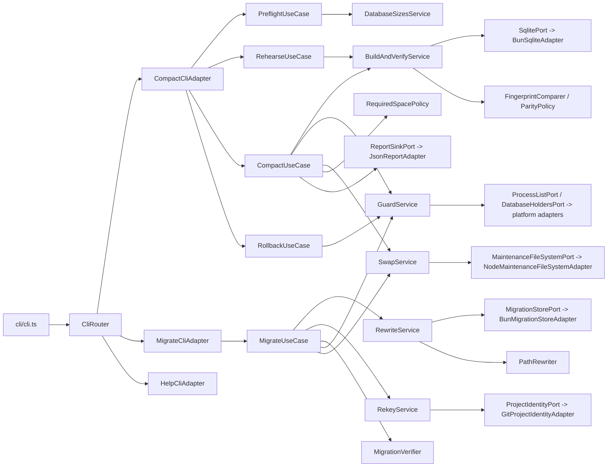
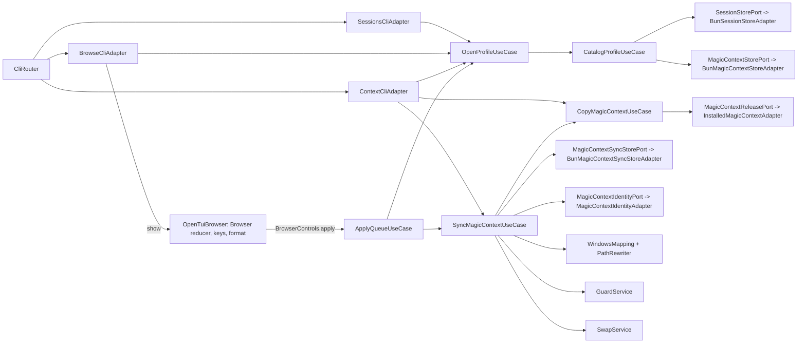

# opencode-session-manager

Tools for working with OpenCode sessions, in two parts:

- **an OpenCode plugin**, used inside OpenCode (below);
- **a standalone program**, `opencode-session-manager` (see
  [The program](#the-program-opencode-session-manager)):
  - a two-pane **session browser** (`tui`) over two OpenCode installations
    (for example this machine's and a Windows machine's), sessions matched by
    id, with what Magic Context holds for each;
  - **Magic Context sync**: copies sessions' Magic Context state (summaries,
    tags, notes, memories) from one installation to the other;
  - offline maintenance of `opencode.db`: verified **compaction** and
    **migration** of another machine's sessions.

  Everything that writes works on copies, checks them, swaps them in by renames
  and keeps the originals for `rollback`.

It replaces three earlier projects, `opencode-session-id`,
`opencode-sessions-transfer` and `opencode-db-manager` (formerly
`opencode-db-compact`), whose histories are merged into this repository.

The plugin:

1. **Session ID in the sidebar** — the active session's ID is the first row of
   the session sidebar, directly under the title, in the theme's muted colour.
2. **The `session-id` tool** — returns the running session's ID to the agent.
3. **`/transfer-session`** (alias `/relocate`, palette "Transfer session") —
   moves a session to any folder: another project, a plain folder, or a folder
   that does not exist yet (it is created).

```
┌ sidebar ─────────────────────────────┐
│ <session title>                      │
│                                      │
│ ses_0123456789abCDEFGHIJKLMNOP       │  ← prepend on sidebar.content
│ Context …                            │
```

## OpenCode compatibility

| Host | Tested plugin SDK | Features | Built entrypoints |
|---|---|---|---|
| OpenCode 2 (2.0.14 contract; verified on 2.0.24) | `@opencode/plugin@2.0.14` | all three | `dist/v2/server.js`, `dist/v2/tui.js` |
| OpenCode 1.18.32 | `@opencode-ai/plugin@1.18.32` | `/transfer-session` | `dist/v1/session-manager.js`, `dist/v1/session-manager.tui.js` |

### OpenCode 2

- `dist/v2/server.js` registers the `session-id` tool.
- `dist/v2/tui.js` prepends the ID line to `sidebar.content` and registers
  `/transfer-session` from an `app` slot (where `keymap.layer` runs in-tree).
  Its cleanup removes both.

The move goes through the host's `session.move` API — no database writes — so
the host re-resolves the project and tells the agent about the new directory.
Over the built-in `/cd` and `/worktrees`, the plugin adds a picker over every
project root, worktree and session directory across projects, moving a session
other than the open one, and creating a destination that does not exist yet.

### OpenCode 1

v1 has no session-move API, so `/transfer-session` writes the v1 SQLite store
directly and resolves the destination project exactly as the v1.18.32 host does
(`sha1("git-remote:<host>/<path>")` of `origin`, else the id cached in
`<git-common-dir>/opencode`, else the first root commit, else `global`), then
leaves a synthetic reminder so the agent adopts the new directory.

## What it can and cannot do

The plugin:

- The title box has no plugin slot, so the ID is the first row of the sidebar's
  scroll area and scrolls with the sidebar content. No OpenCode setting
  (`opencode.jsonc` or `cli.json`) shows the session ID.
- The sidebar only appears when the terminal is wide enough
  (`session.sidebar: "auto"` in `cli.json`).
- The transfer dialog cannot autocomplete paths live or drill into folders with
  the arrow keys: the plugin dialog API exposes no filter handle or bindings. It
  lists every known directory instead, plus "Enter custom path…" (`~` works).

The program:

- It copies **Magic Context state**, not OpenCode sessions: a session must
  already exist on both sides under the same id (after a `migrate`, for
  example). Copying sessions themselves is the next step
  (`docs/research/2026-10-08-22-39-session-sync-design.md`).
- Anything that writes needs OpenCode closed (`opencode service stop`): it
  refuses while a process holds the target store open, and never kills one.
  Stopping OpenCode also stops a running Magic Context `/ctx-wrapup`.
- A Magic Context store is never migrated down: a source in a newer format than
  the target is refused until Magic Context is updated where the target is used.
- Summaries Magic Context wrote for an older copy of a session (for example in
  the OpenCode 1 era) point at messages the session no longer has; they are
  skipped (`stale-anchors`), never copied.
- A `dir:` Magic Context project is a hash of the folder's path, so it differs
  between machines; a session whose folder does not exist here, and is not in a
  git repository, gets no project (`no-project`) and is skipped.
- It does not rebuild Magic Context summaries; a session whose summaries lag far
  behind its history needs `/ctx-wrapup` in OpenCode.

## Install the plugin

```
bun install --frozen-lockfile
bun run install:plugin:v2      # or install:plugin:v1 for an OpenCode 1 host
```

The v2 installer builds, then writes the folder `<plugins>/session-manager/`
(`server.js`, `tui.js`); the v1 installer writes `session-manager.js` and
`session-manager.tui.js`. `<plugins>` is `OPENCODE_V2_PLUGIN_DIR` /
`OPENCODE_V1_PLUGIN_DIR`, else `$XDG_CONFIG_HOME/opencode/plugins` (default
`~/.config/opencode/plugins`), where the host auto-discovers it. Either lane
removes the other lane's files and those of the two plugins this one replaces
(`session-id/`, `sessions-transfer/`, `sessions-transfer{,.tui}.js`). No
configuration is written. A running v2 host activates the plugin as soon as it
lands; restart the TUI to see the sidebar line.

## The program (`opencode-session-manager`)

`bun run install:cli` builds the single-file program and copies it into
`~/.local/bin` (or `OPENCODE_SESSION_MANAGER_BIN_DIR`), replacing the old copy
by rename, then checks the installed file is identical to the build and answers
`--version`; it warns when that folder is not on `PATH`. Without installing,
`bun run cli -- <command>` runs it from the checkout (OpenTUI's Solid transform
is preloaded by `bunfig.toml`).

```
opencode-session-manager --help | --version

# Read-only: safe while OpenCode runs
opencode-session-manager tui [--left <dataHome> | --left-db <db> [--left-context <db>]] [--right …]
opencode-session-manager sessions [--data <dataHome>] [--json]
opencode-session-manager context copy --from <context.db> --to <file>
opencode-session-manager preflight [--db <path>]

# Write (to copies, swapped in by renames): OpenCode must be closed
opencode-session-manager context sync --from <dataHome> --to <dataHome> (--session <id>... | --all) [--replace] [--dry-run]
opencode-session-manager rehearse [--db <path>] [--keep]
opencode-session-manager run [--db <path>]
opencode-session-manager migrate <rehearse|run> --from <db>... --windows-user <name> \
  [--drive C] [--mount <dir>]... [--relocate <from>=<to>]... [--home <dir>] [--db <path>] [--keep]
opencode-session-manager rollback <backupDir> [--db <path>]
```

`context copy` and `rehearse` write only their own output (a new file, or a
rehearsal folder). The browser reads only, except when it applies its queue.

### Profiles

A **profile** is one OpenCode installation: its `opencode/opencode.db` and, when
Magic Context is installed, its `cortexkit/magic-context/context.db`, both under
one XDG data home (`--data`, `--left`, `--right`, `--from`, `--to`; default
`$XDG_DATA_HOME`, else `~/.local/share`). A store SQLite cannot open where it
lies (for example an NTFS-compressed Windows partition mounted on Linux) is
copied, with its `-wal` and `-shm`, into a temporary folder and read there; the
copy is removed when the command finishes.

`sessions` lists a profile's sessions, newest first, with each one's entry count
and what Magic Context holds for it (history summaries, tags, notes, the
memories it created); `--json` prints the catalog.

### The session browser

`tui` opens two panes, one per profile. Each side is a data home (`--left`,
`--right`) or explicit store files (`--left-db <opencode.db>` with an optional
`--left-context <context.db>`, likewise `--right-db`/`--right-context`); the left
defaults to this machine's profile, the right is optional. Sessions are grouped
by folder, newest first, each with its message count and Magic Context
summaries (`S`) and tags (`T`); a detail panel describes the selected row.

With two sides, sessions are **matched by session id**:

- side by side (`Tab` switches panes), each session is marked against its
  partner: `+` only here, `=` same, `>` newer here, `<` older here; moving in one
  pane selects the same session in the other;
- `p` switches to the **paired list**: one row per session id with both copies
  on the same line (`L` left only, `R` right only, `=` same, `>` left newer,
  `<` right newer).

`Space` marks the session under the cursor (on a folder: all of its sessions),
`*` everything the filter shows. `>` and `<` queue copying the marked sessions'
(or the selected row's) **Magic Context state** to the right or to the left: a
copy needs the session on both sides and state to copy, and when the target has
state of its own the entry is a conflict until you decide. `Q` opens the queue:
`r`/`s` replace or skip a conflict (`R`/`S` all of them), `x` removes an entry,
`c` clears it, `d` checks the queue on copies (a dry run) and `a` applies it
(see [Magic Context sync](#magic-context-sync)); the result replaces the queue
in the details, and the changed side is read again. Applying refuses while the
target store is open. Other keys: `↑↓`/`jk`, `PgUp`/`PgDn`, `g`/`G`, `Enter`
folds a folder, `/` filters by id, title or folder (`Esc` clears), `Esc` leaves
the queue, `q` quits; the mouse selects rows and scrolls a list.

### Magic Context copy

`context copy` copies a Magic Context store and brings the copy to the format
the installed Magic Context writes, so stores from two machines can exchange
rows. The upgrade is Magic Context's own code (the same migrations it runs on
its live store when OpenCode starts), taken from OpenCode's package cache
(`$XDG_CACHE_HOME/opencode`, else `~/.cache/opencode`; the newest installed
version wins, or `OPENCODE_SESSION_MANAGER_MAGIC_CONTEXT` names a package
folder). It runs in a child process whose XDG folders point into a throwaway
sandbox. A store newer than the installed Magic Context is refused.

### Magic Context sync

`context sync` (and the browser's `a`) copies sessions' Magic Context state —
history summaries with their embeddings, tags (same `§N§` numbers) with their
archived contents and pending drops, session notes and facts, and the memories
the session created — from one profile to another, for sessions both profiles
hold under the same id. `--all` takes every such session the source has state
for. A session the target already has state for is kept unless `--replace`
(in the browser: a conflict you decide).

A session is copied only when it is safe: the target's message history must be
the source's or continue it (summaries point at messages by id and position),
and every message a summary points at must be in the target. Otherwise it is
skipped and the report says why (`source-ahead`, `diverged`, `stale-anchors` —
state written for an older copy of the session —, `no-state`, `no-project`,
`not-on-source`, `not-on-target`). The session's Magic Context project on the
target is the one already recorded there, else derived from its folder on this
machine (`git:<root commit>` or `dir:<hash>`, as Magic Context derives it), else
the source's when it is a git identity. A session that moved from a Windows
profile (`C:/Users/<you>/…`) to a folder here has the paths in its copied text
rewritten to this machine's home, and to its new folder if it moved. Memories
are merged into the target project; one with the same text already there is
kept. Magic Context's cached context snapshots for the session are dropped, as
its own session move does.

It works on copies only: both stores are read with `VACUUM INTO` (a source in an
older format is first brought to the target's by the installed Magic Context; a
source newer than the target is refused — update Magic Context where the target
is used first). The copy is checked (integrity, foreign keys, every summary's
messages present, row counts), then replaces the target store by renames, the
original kept in `context-sync-backup-<timestamp>/` beside it:
`opencode-session-manager rollback <backupDir> --db <context.db>` undoes it.
Applying refuses while any process holds the target store open (OpenCode with
Magic Context does): close OpenCode and run `opencode service stop` first.
`--dry-run` builds and checks the copy without touching the target.

### Compaction

`preflight`, `rehearse`, `run` and `rollback` work on
`$XDG_DATA_HOME/opencode/opencode.db` (`~/.local/share/opencode/opencode.db`
when unset); `--db <path>` names another database (`rollback --db` also takes a
Magic Context store, to undo a sync).

OpenCode never compacts its database and SQLite's auto-compaction is off, so a
database that has seen a lot of deletion keeps every freed page. The compacted
copy is made with `VACUUM INTO` from a read-only connection, so the source is
never written, then checked six ways (integrity, foreign keys, zero free pages,
per-table row parity, WAL journal mode, no leftover sidecars). Only then is it
swapped in by renames: the original database and its sidecars move into
`db-backup-<timestamp>/` and stay there. Any failure aborts before the swap and
keeps the failed copy for inspection.

- `run` refuses while the process named by `OPENCODE_DB_COMPACT_IMAGE` (default
  `opencode`, `opencode.exe` on Windows) runs, while any process holds the
  database or a sidecar open, or when there is no room for two copies.
- `rehearse` works in `OPENCODE_DB_COMPACT_REHEARSAL_DIR` (default
  `<temp>/opencode/compact-rehearsal`) and writes `report-<timestamp>.json`
  there; `--keep` keeps the copy. `run` keeps its evidence in
  `db-backup-<timestamp>/report.json`.

### Migration from a Windows machine

`migrate` merges another machine's sessions into the local database, with every
Windows profile path rewritten to this home, so each session shows up under its
folder here as if it had been started on this machine.

1. **Copy** the local database and every `--from` database with `VACUUM INTO`;
   nothing below touches an original.
2. **Rewrite** every text cell except the credential tables and OpenCode's
   migration log: `C:\Users\<user>`, `C:/Users/<user>`, the same escaped once,
   twice or three times inside nested JSON, `file:///C:/…`, `@fs/C:/…`,
   `/mnt/c/…`, `/cygdrive/c/…`, `/c/…`, the drive's mount folder here (`--mount`),
   and the `Users/<user>` form stored below the root project. Only matched paths
   change, so JSON stays byte-identical otherwise. `--relocate <from>=<to>` then
   moves folders that live elsewhere here.
3. **Merge** source rows whose primary key is absent; the local row wins.
4. **Re-key** every session onto the project id OpenCode derives for its folder
   here (`sha1("git-remote:" + host/path)` for a repository with a remote, else
   its stored id, else its root commit; `sha1("directory:" + realpath)` for a
   plain folder), and recompute `session.path`. A session whose folder is missing
   keeps its project and is listed in the report.
5. **Verify** seven gates (integrity, foreign keys, rows kept, no Windows session
   folder, clean folder columns, consistent subpaths, intact JSON), then **swap**
   (`run` only) exactly as compaction does. `rollback` undoes it.

`migrate rehearse` works in `OPENCODE_DB_MIGRATE_REHEARSAL_DIR` (default
`<temp>/opencode/migrate-rehearsal`). A Windows `opencode.db` on an NTFS
partition is often NTFS-compressed, which Linux's `ntfs3` driver cannot open for
SQLite: copy the `.db`, `-wal` and `-shm` files to a Linux filesystem first.

## Architecture

Strict hexagonal, dependencies point inward only; the full contract is in
`AGENTS.md`. There is one composition root per host runtime, because the
entrypoints load into different processes.



The CLI has its own composition root, `src/main/cli-container.ts`, plus one
per operating system (`src/main/linux-container.ts`, `src/main/win32-container.ts`),
loaded on demand by `src/main/cli/platform.ts`. `CliRouter` sends each command
family to its inbound adapter. Database maintenance:



Sessions and Magic Context:



Composition roots: `src/main/server-container.ts` (v2 server),
`src/main/tui-container.ts` (v2 TUI), `src/main/v1-container.ts` (v1 TUI).
Entrypoints: `src/main/v2/server.ts`, `src/main/v2/tui.ts`,
`src/main/v1/server.ts`, `src/main/v1/tui.ts`. `scripts/build.mjs` binds the v2
TUI bundle to the host's shared Solid/OpenTUI runtime.

## Build and test

```
bun install --frozen-lockfile
bun run typecheck                 # tsc --noEmit
bun run build                     # dist/v2, dist/v1 and the compiled dist/cli/opencode-session-manager
bun run test                      # the four tiers in order; or one tier:
bun run test:unit
bun run test:component
bun run test:e2e
bun run test:live
bun run coverage                  # bun run coverage:unit && bun run coverage:e2e
bun run lint:diagrams             # docs lint (fences, mermaid, paths, scripts, source map, variables)
bun run cli -- <command>          # the program from the checkout
bun run install:plugin:v2         # or bun run install:plugin:v1
bun run validate:installed:v2     # or bun run validate:installed:v1
bun run install:cli
bun run validate:installed:cli
```

The four tiers live under `tests/{unit,component,e2e,live}`:

- **unit** — one class at a time with stand-ins, plus the architecture, SOLID,
  platform, host-fixture and coverage-completeness gates. Coverage-gated.
- **component** — the wired plugin painted by the real OpenTUI renderer, the
  tool's parity with the hand-written plugin it replaced, and real SQLite
  compacting and migrating real databases over real folders and git repositories.
- **e2e** — the real entries in-process: the v2 TUI loaded by the real 2.0.14
  `Host`, the v1 entries over a real SQLite store and real git repositories, and
  the CLI's container over real databases, including a same-behaviour comparison
  with the frozen original compactor (`tests/support/maintenance/fixtures/legacy/`),
  Magic Context syncs between real stores, and the browser applying its queue
  in OpenTUI's test renderer. Coverage-gated, per platform.
- **live** — the real `opencode` executable, the built bundles, the installers,
  and the real TUI in a pseudo-terminal (sidebar line and `/transfer-session`),
  all under isolated XDG directories; for the CLI, a read-only snapshot of the
  real `opencode.db` through preflight, a full run and a rollback, the compiled
  browser in a pseudo-terminal, and the installed Magic Context upgrading and
  opening real store copies. Invisible to coverage by construction.

`bun run coverage` requires 100 % lines and functions on every `src` file, in the
unit and the e2e tier separately. The e2e gate is per platform: each platform's
run gates every file except the other platforms' adapters and containers. The
live tier needs `node` (for the pseudo-terminal).

### Environment variables

| Variable | Read by | Meaning |
|---|---|---|
| `XDG_DATA_HOME` | the program, the v1 plugin | default data home (`~/.local/share`) |
| `XDG_CACHE_HOME` | the program | where OpenCode's package cache, and so the installed Magic Context, is found (`~/.cache`) |
| `XDG_CONFIG_HOME` | the installers | the plugins folder (`~/.config/opencode/plugins`) |
| `XDG_STATE_HOME`, `XDG_CONFIG_HOME`, `XDG_DATA_HOME`, `XDG_CACHE_HOME` | `InstalledMagicContextAdapter` | pointed into a throwaway sandbox for the child process that runs Magic Context's code |
| `OPENCODE_DB_PATH` | the v1 plugin | the OpenCode 1 store, as the v1 host reads it |
| `OPENCODE_DB_COMPACT_IMAGE` | `preflight`, `run`, `rollback`, `migrate` | the OpenCode process name: `preflight` reports it, the others refuse while it runs (`opencode`, `opencode.exe` on Windows) |
| `OPENCODE_DB_COMPACT_REHEARSAL_DIR` | `rehearse` | rehearsal folder (`<temp>/opencode/compact-rehearsal`) |
| `OPENCODE_DB_MIGRATE_REHEARSAL_DIR` | `migrate rehearse` | rehearsal folder (`<temp>/opencode/migrate-rehearsal`) |
| `OPENCODE_SESSION_MANAGER_MAGIC_CONTEXT` | `context copy`, `context sync` | a Magic Context package folder, instead of the newest in OpenCode's cache |
| `OPENCODE_SESSION_MANAGER_BIN_DIR` | `install:cli` | install folder (`~/.local/bin`) |
| `OPENCODE_V2_PLUGIN_DIR`, `OPENCODE_V1_PLUGIN_DIR` | the plugin installers | the plugins folder of each lane |
| `OPENCODE_V2_EXECUTABLE` | live tier | the OpenCode 2 executable (else `~/.opencode/bin/opencode`, `~/.local/bin/opencode.exe` on Windows, else `PATH`) |
| `OPENCODE_BIN` | live migration test | the `opencode` that lists a migrated store (default `opencode` on `PATH`) |
| `OPENCODE_DB_MIGRATE_LIVE_SOURCE`, `OPENCODE_DB_MIGRATE_LIVE_USER`, `OPENCODE_DB_MIGRATE_LIVE_MOUNT` | live migration test | a Windows `opencode.db`, its profile user and its mount folder; the test is skipped without the first two |
| `OPENCODE_SM_LIVE_OLD_CONTEXT` | live `context copy` test | an older `context.db` to upgrade with the installed Magic Context |
| `OPENCODE_SM_LIVE_OTHER_PROFILE` | live `context sync` test | another profile's data home to sync into a copy of this machine's; skipped without it |
| `OPENCODE_TEST_HOME`, `OPENCODE_DISABLE_AUTOUPDATE`, `OPENCODE_SERVER_PASSWORD` | `tests/support/live/isolated-host.ts` | set for the isolated OpenCode the live tier starts: its home, no self-update, a fixed server password |

## License

MIT © mavasbel
