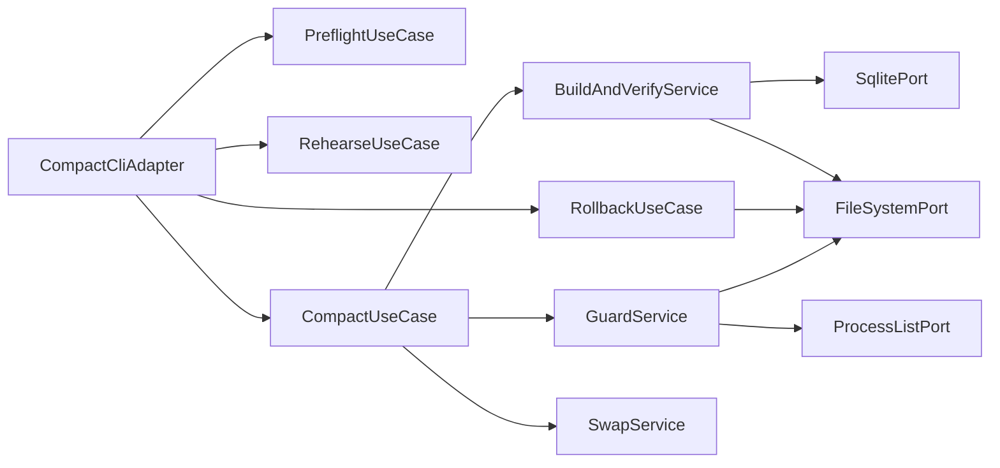

# opencode-db-compact

Offline, verified compaction of an OpenCode 2 `opencode.db`.

OpenCode never compacts its own database, and SQLite's auto-compaction is off, so
a database that has seen a lot of deletion keeps every freed page inside the
file. On the machine this was written for, `opencode.db` had grown to **16.44 GB,
of which 15.13 GB was free space**. This tool reclaims that space — but only
offline, and only after proving the replacement is correct.

## How it works

```
preflight  read-only: sizes, page statistics, free disk, running OpenCode
rehearse   build a compacted copy and verify it; keep it only with --keep
run        guard, build, verify, swap, write evidence — the real thing
rollback   put the originals back, park what was in place
```

The compaction is `VACUUM INTO` from a read-only connection, so **the source file
is never written**. The copy is then checked six ways — integrity, foreign keys,
zero free pages, per-table row parity, WAL journal mode, no leftover sidecars —
and only if every check passes is it swapped in. The swap is renames only: the
original database and its sidecars move into `db-backup-<timestamp>/` and stay
there.

If anything fails, the run **aborts before the swap** and prints where the failed
copy was kept. Nothing is deleted and no process is ever killed.

## Usage

Requires Node.js 24.14.1 or newer. Run it with every OpenCode window closed.

```
npm run typecheck
node src/main/cli.ts preflight
node src/main/cli.ts rehearse --keep
node src/main/cli.ts run
```

The database defaults to `%XDG_DATA_HOME%/opencode/opencode.db`
(`~/.local/share/opencode/opencode.db` when unset); override it with `--db <path>`.

- `run` refuses to start while the process named by
  `OPENCODE_DB_COMPACT_IMAGE` (default `opencode.exe`) is running, while the file
  is held open by another connection, or when there is not room for two copies.
- `rehearse` uses `OPENCODE_DB_COMPACT_REHEARSAL_DIR` (default:
  `<temp>/opencode/compact-rehearsal`) and writes a `report-<timestamp>.json`
  there. Add `--keep` to keep the compacted copy.
- `run` keeps its evidence in `db-backup-<timestamp>/report.json`.

**Rollback:** close OpenCode, then

```
node src/main/cli.ts rollback "C:\path\to\db-backup-<timestamp>" --db "C:\path\to\opencode.db"
```

## Architecture

Strict hexagonal, dependencies point inward only; the full contract is in
`AGENTS.md`.



Key files:

- `src/domain/services/FingerprintComparer.ts` — schema, header and per-row proofs
- `src/application/BuildAndVerifyService.ts` — the six checks
- `src/application/GuardService.ts` — nothing running, file present, not held, room to work
- `src/application/SwapService.ts` — renames with restore-on-failure
- `src/main/container.ts` — the single composition root
- `src/main/cli.ts` — the entrypoint

## Build and test

```
npm install
npm run typecheck
npm run test
npm run coverage
npm run lint:diagrams
```

The four tiers live under `tests/{unit,component,e2e,live}`:

- **unit** — one class at a time with in-memory fakes; adapters against real temp
  files; plus the architecture gate.
- **component** — real SQLite and a real filesystem compacting a real database.
- **e2e** — the whole wired container in-process over real databases, plus a
  same-behaviour comparison against the pre-restructure implementation kept
  verbatim under `tests/support/fixtures/legacy/`.
- **live** — a read-only snapshot of the real `opencode.db`, then the real CLI as
  a process: preflight, a full run and a rollback. Takes a couple of minutes on a
  multi-gigabyte database; skipped with a message when no database is present.

`npm run coverage` requires **100 % lines and functions on every file under
`src/`**, on the unit tier and on the e2e tier independently.

## Notes

- Windows-first: the running-process guard reads `tasklist`, and the
  "is the database held open" probe relies on Windows refusing to rename a file
  that has an open handle. The rest is platform-neutral.
- `node:sqlite` is still marked experimental and prints a warning; the scripts
  pass `--no-warnings`.

## License

MIT © mavasbel
