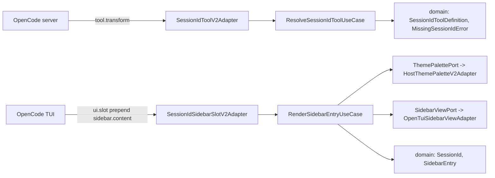

# opencode-session-id

An OpenCode 2.0.14 plugin that:

1. shows the active session ID in the session sidebar, as the first row under
   the session title (in the theme's muted colour);
2. provides the `session-id` tool, behaving identically to the hand-written
   `session-id/index.js` it replaces.

```
┌ sidebar ─────────────────────────────┐
│ <session title>                      │
│                                      │
│ ses_0123456789abCDEFGHIJKLMNOP       │  ← this plugin (prepend on sidebar.content)
│ Context …                            │
```

## What it can and cannot do

- The title box has no plugin slot, so the ID is the first row of the sidebar's
  scroll area and scrolls with the sidebar content.
- The sidebar only appears when the terminal is wide enough (`session.sidebar: "auto"`).
- OpenCode 1.x is not supported: the plugin targets the 2.0.14 contract only.

## Architecture

Strict hexagonal, dependencies point inward only; the full contract is in
`AGENTS.md`. There is one composition root per host runtime, because the server
and TUI entrypoints load into different processes — a shared root would pull the
OpenTUI view (and its native packages) into the server bundle.



Key files:

- `src/domain/tool/SessionIdToolDefinition.ts` — the tool's name, description, schema and error text
- `src/domain/model/SessionId.ts`, `src/domain/model/SidebarEntry.ts`
- `src/application/ResolveSessionIdToolUseCase.ts`, `src/application/RenderSidebarEntryUseCase.ts`
- `src/infrastructure/adapters/inbound/server/SessionIdToolV2Adapter.ts`
- `src/infrastructure/adapters/inbound/tui/SessionIdSidebarSlotV2Adapter.ts`
- `src/infrastructure/adapters/outbound/tui/HostThemePaletteV2Adapter.ts`
- `src/infrastructure/adapters/outbound/tui/OpenTuiSidebarViewAdapter.tsx`
- `src/main/server-container.ts`, `src/main/tui-container.ts` — the two composition roots
- `src/main/v2/server.ts`, `src/main/v2/tui.ts` — the deployed entrypoints
- `scripts/build.mjs` — binds the TUI bundle to the host's shared Solid/OpenTUI runtime

## Build and test

```
bun install --frozen-lockfile
bun run typecheck
bun run test
bun run coverage
bun run lint:diagrams
```

The four test tiers live under `tests/{unit,component,e2e,live}`:

- **unit** — one class at a time, with stand-ins; includes the architecture and
  SOLID gates.
- **component** — the wired plugin painted by the real OpenTUI renderer.
- **e2e** — this plugin's source driven end to end by the real OpenCode 2.0.14
  host code *in-process* (its real plugin resolver, tool registry, sidebar slot
  and renderer). This is the tier coverage can measure.
- **live** — the real `opencode.exe`, the built bundles, the installer, and the
  real TUI in a Windows pseudo-terminal (200×50). Real by construction, and by
  construction invisible to any coverage tool.

`bun run coverage` gates the **unit** and **e2e** tiers, each of which reaches
100% lines and functions on every `src` file on its own
(`bunfig.coverage.toml`).

## Install

Installers never edit `opencode.jsonc`; the plugin root always comes from the
environment.

```
set OPENCODE_V2_PLUGIN_ROOT=%USERPROFILE%\.config\opencode\v2-plugins
bun run deploy:v2
```

`deploy:v2` builds, stages the bundles as an immutable content-addressed release
under `session-id\releases\sha256-…\`, then writes the two shim files — backing
up any existing `session-id\index.js` / `tui.js` into `session-id\backup-<timestamp>\`
first:

- `session-id\index.js` → `export { default } from "file:///…/releases/sha256-…/server.js"`
- `session-id\tui.js` → `export { default } from "file:///…/releases/sha256-…/tui.js"`

The `session-id` folder is already in the `plugins` list of the user's
`opencode.jsonc`, so no configuration change is needed. Restart OpenCode to load it.

The staging and shim steps are also available separately as `bun run install:plugin:v2`,
`bun run validate:installed:v2` and `bun run shims:installed:v2` (the last two
read `OPENCODE_V2_RELEASE_DIRECTORY`).

**Rollback:** copy `backup-<timestamp>\index.js` back over `session-id\index.js`
and delete `session-id\tui.js`.

## License

MIT © mavasbel
