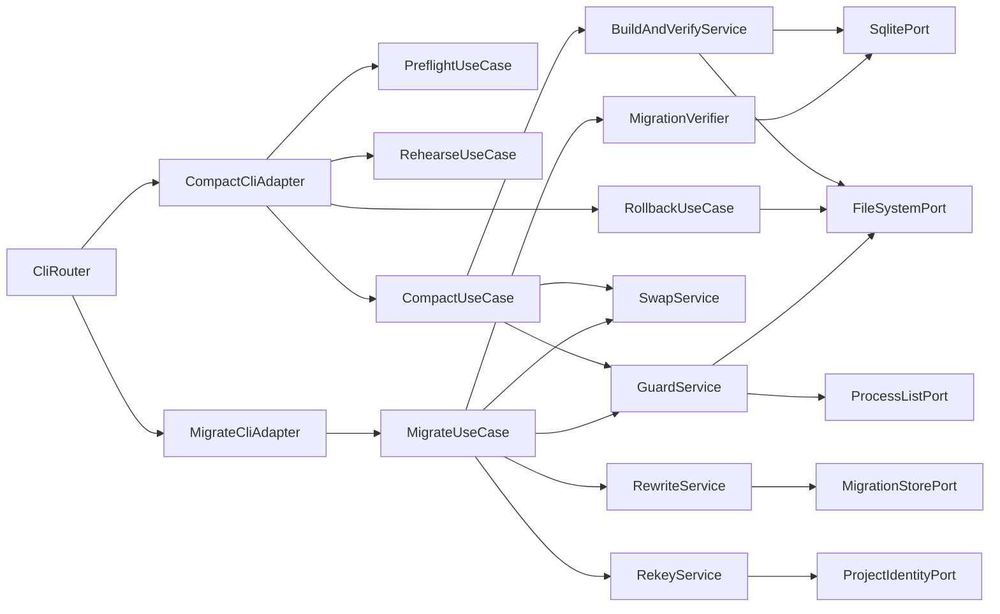

# opencode-db-manager

Offline, verified maintenance of an OpenCode 2 `opencode.db`, on Linux and
Windows: **compaction**, and **migration** of sessions from another machine.
Formerly `opencode-db-compact`.

## Compaction

OpenCode never compacts its own database, and SQLite's auto-compaction is off, so
a database that has seen a lot of deletion keeps every freed page inside the
file. On the machine this was written for, `opencode.db` had grown to **16.44 GB,
of which 15.13 GB was free space**. This tool reclaims that space — but only
offline, and only after proving the replacement is correct.

### How it works

```
preflight  read-only: sizes, page statistics, free disk, running OpenCode
rehearse   build a compacted copy and verify it; keep it only with --keep
run        guard, build, verify, swap, write evidence — the real thing
rollback   put the originals back, park what was in place
```

The compaction is `VACUUM INTO` from a read-only connection, so **the source file
is never written**. The copy is then checked six ways — integrity, foreign keys,
zero free pages, per-table row parity, WAL journal mode, no leftover sidecars —
and only if every check passes is it swapped in. The swap is renames only: the
original database and its sidecars move into `db-backup-<timestamp>/` and stay
there.

If anything fails, the run **aborts before the swap** and prints where the failed
copy was kept. Nothing is deleted and no process is ever killed.

### Usage

Requires Node.js 24.14.1 or newer. Run it with every OpenCode window closed.

```
npm run typecheck
node src/main/cli.ts preflight
node src/main/cli.ts rehearse --keep
node src/main/cli.ts run
```

The database defaults to `%XDG_DATA_HOME%/opencode/opencode.db`
(`~/.local/share/opencode/opencode.db` when unset); override it with `--db <path>`.

- `run` refuses to start while the process named by
  `OPENCODE_DB_COMPACT_IMAGE` (default `opencode` on Linux, `opencode.exe` on
  Windows) is running, while any process holds the database or a sidecar open
  (the refusal names the holders on Linux), or when there is not room for two copies.
- `rehearse` uses `OPENCODE_DB_COMPACT_REHEARSAL_DIR` (default:
  `<temp>/opencode/compact-rehearsal`) and writes a `report-<timestamp>.json`
  there. Add `--keep` to keep the compacted copy.
- `run` keeps its evidence in `db-backup-<timestamp>/report.json`.

**Rollback:** close OpenCode, then

```
node src/main/cli.ts rollback <path>/db-backup-<timestamp> --db <path>/opencode.db
```

## Migration

Moves OpenCode sessions from a Windows machine into this one: copy the Windows
`opencode.db` here, and every session, message and tool call is merged into the
local database with its paths rewritten from the Windows profile to this home.
Afterwards each session shows up under its folder here, exactly as if it had been
started on this machine.

### How it works

```
migrate rehearse   build the migrated copy and verify it; keep it only with --keep
migrate run        guard, build, verify, swap, write evidence; undo with rollback
```

1. **Copy.** The live database and every `--from` database are copied with
   `VACUUM INTO` from read-only connections. Nothing below touches an original.
2. **Rewrite.** Every text cell of every table except the credential tables and
   OpenCode's migration log is rewritten: `C:\Users\<user>`, `C:/Users/<user>`,
   the same paths escaped once, twice or three times inside nested JSON,
   `file:///C:/…`, `@fs/C:/…`, `/mnt/c/…`, `/cygdrive/c/…`, `/c/…`, the folder the
   Windows drive is mounted at here (`--mount`), and the `Users/<user>` form stored
   below the root project. Only the matched path changes, so JSON numbers, escapes
   and key order stay byte-identical. `--relocate <from>=<to>` then moves folders
   that live somewhere else here.
3. **Merge.** Rows of the sources whose primary key is not in the local database
   are inserted; on a shared key the local row wins.
4. **Re-key.** OpenCode lists a folder's sessions only under the project id it
   derives itself — `sha1("git-remote:" + host/path)` of a repository's remote,
   else its stored id, else its root commit, and `sha1("directory:" + realpath)`
   for a plain folder — so every session gets the project derived for its folder
   on this machine, and `session.path` is recomputed. A session whose folder does
   not exist here keeps its project (listed in the report, so a `--relocate` can be
   added). Projects nothing uses any more are removed.
5. **Verify.** The compacted result must pass seven gates: integrity, foreign
   keys, no input row lost, no session folder left on Windows, no Windows profile
   path in the folder columns OpenCode reads, every `session.path` consistent with
   its project, and no JSON cell broken by the rewrite. Paths left in history
   text (binary dumps, terminal output) are counted in the report, not rewritten.
6. **Swap** (`run` only, only if every gate passed): the same renames-only swap
   as compaction, originals kept in `db-backup-<timestamp>/`.

### Usage

Close OpenCode first (`opencode service stop` as well, if the service runs).

```
node src/main/cli.ts migrate rehearse --from /path/to/windows/opencode.db --windows-user <name> \
  --mount /run/media/<me>/Windows --relocate ~/Old/place=~/New/place --keep
node src/main/cli.ts migrate run      --from /path/to/windows/opencode.db --windows-user <name> \
  --mount /run/media/<me>/Windows --relocate ~/Old/place=~/New/place
```

| Option | Meaning |
|---|---|
| `--from <db>` | a database to merge in; repeatable |
| `--windows-user <name>` | the Windows profile folder (`C:\Users\<name>`) to rewrite |
| `--drive <letter>` | the profile's drive, default `C` |
| `--mount <dir>` | where that drive is mounted here; repeatable |
| `--relocate <from>=<to>` | a folder that lives elsewhere here; repeatable, applied in order |
| `--home <dir>` | the home the profile maps to, default this user's home |
| `--db <path>` | the local database, default as for compaction |
| `--keep` | keep the migrated copy after a rehearsal |

`migrate rehearse` works in `OPENCODE_DB_MIGRATE_REHEARSAL_DIR` (default
`<temp>/opencode/migrate-rehearsal`) and leaves `report.json` there. To check the
copy in a private OpenCode, point `XDG_DATA_HOME`, `XDG_STATE_HOME`,
`XDG_CACHE_HOME` and `XDG_CONFIG_HOME` at an empty folder, put the copy at
`$XDG_DATA_HOME/opencode/opencode.db`, and run
`opencode session list --standalone --format json` inside a project folder.
`migrate run` prints the exact `rollback` command that undoes it.

A Windows `opencode.db` on an NTFS partition is often NTFS-compressed, which the
Linux `ntfs3` driver cannot open for SQLite; copy the `.db`, `-wal` and `-shm`
files to a Linux filesystem first and pass the copy.

## Architecture

Strict hexagonal, dependencies point inward only; the full contract is in
`AGENTS.md`.



Key files:

- `src/domain/services/FingerprintComparer.ts` — schema, header and per-row proofs
- `src/application/BuildAndVerifyService.ts` — the six checks
- `src/application/GuardService.ts` — nothing running, file present, not held, room to work
- `src/main/platform.ts` — picks the Linux (`/proc`) or Windows (`tasklist`, rename probe) adapters
- `src/application/SwapService.ts` — renames with restore-on-failure
- `src/domain/services/PathRewriter.ts` — every Windows path form, at any JSON depth
- `src/infrastructure/adapters/outbound/GitProjectIdentityAdapter.ts` — OpenCode's project ids
- `src/application/RekeyService.ts` — sessions onto the projects derived here
- `src/application/MigrationVerifier.ts` — the seven migration gates
- `src/main/container.ts` — the single composition root
- `src/main/cli.ts` — the entrypoint

## Build and test

```
npm install
npm run typecheck
npm run test
npm run coverage
npm run lint:diagrams
```

The four tiers live under `tests/{unit,component,e2e,live}`:

- **unit** — one class at a time with in-memory fakes; adapters against real temp
  files; plus the architecture gate.
- **component** — real SQLite and a real filesystem compacting a real database,
  and migrating real databases over real folders and real git repositories.
- **e2e** — the whole wired container in-process over real databases, plus a
  same-behaviour comparison against the pre-restructure implementation kept
  verbatim under `tests/support/fixtures/legacy/`.
- **live** — a read-only snapshot of the real `opencode.db`, then the real CLI as
  a process: preflight, a full run and a rollback. Takes a couple of minutes on a
  multi-gigabyte database; skipped with a message when no database is present.
  The migration's live test rehearses a real migration and lists the result in a
  sandboxed OpenCode; it runs when `OPENCODE_DB_MIGRATE_LIVE_SOURCE` (a Windows
  `opencode.db`) and `OPENCODE_DB_MIGRATE_LIVE_USER` are set, with
  `OPENCODE_DB_MIGRATE_LIVE_MOUNT` and `OPENCODE_BIN` optional.

`npm run coverage` requires **100 % lines and functions on every file under
`src/`**, on the unit tier and on the e2e tier independently.

## Notes

- Linux reads `/proc` for both guards. Windows reads `tasklist` and relies on
  Windows refusing to rename a file that has an open handle. Other platforms are
  refused. `npm run coverage` gates the e2e tier on the current platform's files only.
- `node:sqlite` is still marked experimental and prints a warning; the scripts
  pass `--no-warnings`.

## License

MIT © mavasbel
