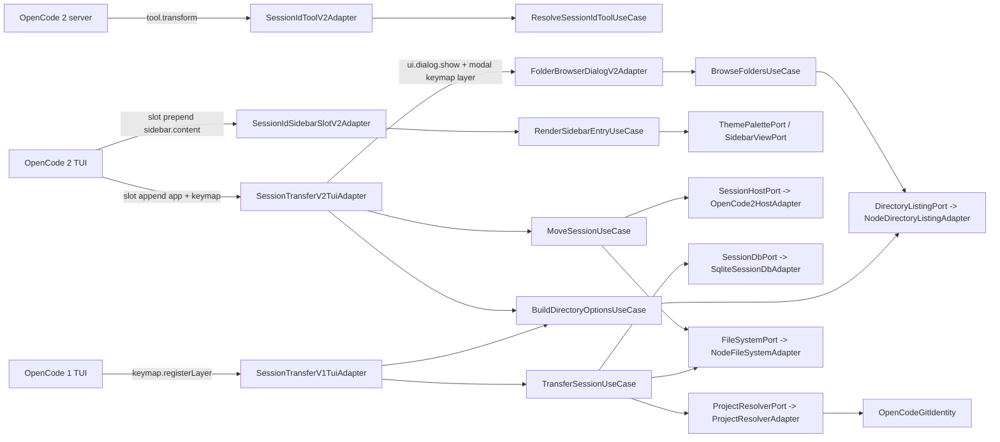
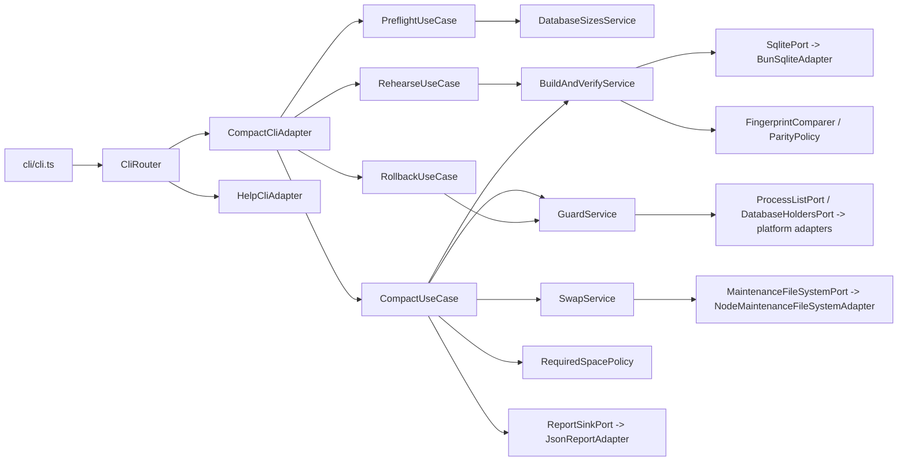
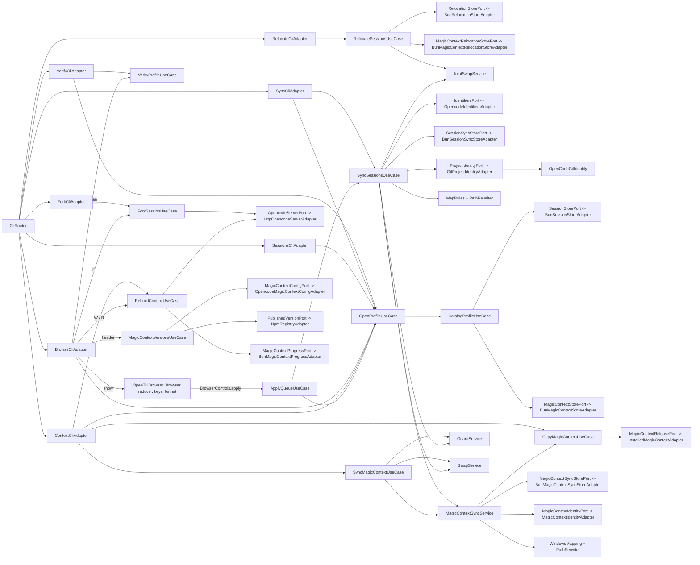

# opencode-session-manager

Tools for working with OpenCode sessions, in two parts:

- **an OpenCode plugin**, used inside OpenCode (below);
- **a standalone program**, `opencode-session-manager` (see
  [The program](#the-program-opencode-session-manager)):
  - a two-pane **session browser** (`tui`) over two OpenCode installations
    (for example this machine's and a Windows machine's), sessions matched by
    id, with what Magic Context holds for each;
  - **Magic Context sync**: copies sessions' Magic Context state (summaries,
    tags, notes, memories) from one installation to the other;
  - **session sync**: whole sessions with their Magic Context state, between
    two profiles (for example a Windows machine's and this one's);
  - offline maintenance of `opencode.db`: verified **compaction**.

  Everything that writes works on copies, checks them, swaps them in by renames
  and keeps the originals for `rollback`.

It replaces three earlier projects, `opencode-session-id`,
`opencode-sessions-transfer` and `opencode-db-manager` (formerly
`opencode-db-compact`), whose histories are merged into this repository.

The plugin:

1. **Session ID in the sidebar** — the active session's ID is the first row of
   the session sidebar, directly under the title, in the theme's muted colour.
2. **The `session-id` tool** — returns the running session's ID to the agent.
3. **`/transfer-session`** (palette "Transfer session") — moves a session to
   any folder: another project, a plain folder, or a folder that does not exist
   yet (it is created after a second Enter).

```
┌ sidebar ─────────────────────────────┐
│ <session title>                      │
│                                      │
│ ses_0123456789abCDEFGHIJKLMNOP       │  ← prepend on sidebar.content
│ Context …                            │
```

## OpenCode compatibility

| Host | Tested plugin SDK | Features | Built entrypoints |
|---|---|---|---|
| OpenCode 2 (2.0.14 contract; verified on 2.0.24) | `@opencode/plugin@2.0.14` | all three | `dist/v2/server.js`, `dist/v2/tui.js` |
| OpenCode 1.18.32 | `@opencode-ai/plugin@1.18.32` | `/transfer-session` | `dist/v1/session-manager.js`, `dist/v1/session-manager.tui.js` |

### OpenCode 2

- `dist/v2/server.js` registers the `session-id` tool.
- `dist/v2/tui.js` prepends the ID line to `sidebar.content` and registers
  `/transfer-session` from an `app` slot (where `keymap.layer` runs in-tree).
  Its cleanup removes both.

The move goes through the host's `session.move` API — no database writes — so
the host re-resolves the project and tells the agent about the new directory.
Over the built-in `/cd` and `/worktrees`, the plugin adds a folder browser over
every project root, worktree and session folder across projects, moving a
session other than the open one, and creating a destination that does not exist
yet.

The folder browser is a path box over a list:

```
Transfer session (tiqP1s5d)                                      esc
~/Dev/repos/
› ~/Dev/repos  · this folder
  ~/Dev/repos/inference-router
  ~/Dev/repos/ITAM
  ~/Dev/repos/opencode
↑↓ select   → open folder   ← parent folder   enter move here   esc cancel
```

- Empty, it lists the known folders that still exist, each once, in display
  order (under `~` first, a parent before its children, ignoring case); text
  that is not a path filters them.
- A path (`~/…`, `/…`) lists that folder first, then the folders inside it
  whose names start with what is typed; the first completion is highlighted.
  Hidden folders appear once the name starts with `.`.
- **→** opens the highlighted folder, **←** goes to the parent folder (the name
  being typed first), **↑/↓** (PgUp/PgDn) select, **Enter** moves the session
  there, **Esc** closes. A folder that does not exist is marked `· new folder`
  and needs a second Enter, which creates it.
- Long paths are shortened in the middle, so their end stays visible.

Magic Context follows the move on the session's next prompt (it links the
session to the project of its new folder). Memories the session created stay
with the old project, and old paths in its history are not rewritten: for a
whole folder that moved, use the program's `relocate`.

### OpenCode 1

v1 has no session-move API, so `/transfer-session` writes the v1 SQLite store
directly and resolves the destination project exactly as the v1.18.32 host does
(`sha1("git-remote:<host>/<path>")` of `origin`, else the id cached in
`<git-common-dir>/opencode`, else the first root commit, else `global`), then
leaves a synthetic reminder so the agent adopts the new directory.

## What it can and cannot do

The plugin:

- The title box has no plugin slot, so the ID is the first row of the sidebar's
  scroll area and scrolls with the sidebar content. No OpenCode setting
  (`opencode.jsonc` or `cli.json`) shows the session ID.
- The sidebar only appears when the terminal is wide enough
  (`session.sidebar: "auto"` in `cli.json`).
- On OpenCode 1 the transfer keeps the host's list dialog: the known folders
  plus "Enter custom path…" (`~` works), without the folder browser.

The program:

- `sync` writes POSIX paths only: a Windows profile can be a source, not a target.
- Two sessions whose histories differ after a shared beginning (`diverged`) are
  never merged: they are skipped, or with `--diverged fork` (the browser's `f`)
  the source's version is written as a new session, an OpenCode fork of the
  target's. Two histories that differ from their first message share nothing to
  fork from and are skipped (`nothing-shared`).
- A fork's Magic Context state is not copied: Magic Context (0.47 on) gives a
  fork its parent's state itself, when the first prompt is sent in the fork. An
  older Magic Context leaves the fork without state until it summarises it.
- Two profiles whose OpenCode stores are at different OpenCode migrations are
  refused: start the same OpenCode version on both once, then sync.
- A project Magic Context's own module manages (its Rust authority) is never
  written from outside: its sessions are skipped (`authority-managed`).
- A store holding tables or columns this program's schemas do not describe
  (written by a newer OpenCode or Magic Context) is refused rather than copied
  incompletely; regenerate the schemas (`bun run schema`, see AGENTS.md).
- Magic Context's scheduler state, caches and search indexes are machine-local
  and rebuilt by Magic Context; they are never copied.
- Anything that writes needs OpenCode closed (`opencode service stop`): it
  refuses while a process holds the target store open, and never kills one.
  Stopping OpenCode also stops a running Magic Context `/ctx-wrapup`.
- A Magic Context store is never migrated down: a source in a newer format than
  the target is refused until Magic Context is updated where the target is used.
- Summaries Magic Context wrote for an older copy of a session (for example in
  the OpenCode 1 era) point at messages the session no longer has; they are
  skipped (`stale-anchors`), never copied.
- A `dir:` Magic Context project is a hash of the folder's path, so it differs
  between machines; a session whose folder does not exist here, and is not in a
  git repository, gets no project (`no-project`) and is skipped.
- It does not summarise anything itself: `context wrapup` / `context recomp`
  (and the browser's `W` / `R`) ask the running OpenCode to run Magic Context's
  own `/ctx-wrapup` / `/ctx-recomp`, so they need OpenCode running, work only on
  this machine's profile, and spend historian tokens. OpenCode answers before the
  command ends and says nothing about it afterwards; progress is read from the
  store. OpenCode refuses a session whose folder no longer exists (404).

## Install the plugin

```
bun install --frozen-lockfile
bun run install:plugin:v2      # or install:plugin:v1 for an OpenCode 1 host
```

The v2 installer builds, then writes the folder `<plugins>/session-manager/`
(`server.js`, `tui.js`); the v1 installer writes `session-manager.js` and
`session-manager.tui.js`. `<plugins>` is `OPENCODE_V2_PLUGIN_DIR` /
`OPENCODE_V1_PLUGIN_DIR`, else `$XDG_CONFIG_HOME/opencode/plugins` (default
`~/.config/opencode/plugins`), where the host auto-discovers it. Either lane
removes the other lane's files and those of the two plugins this one replaces
(`session-id/`, `sessions-transfer/`, `sessions-transfer{,.tui}.js`). No
configuration is written. A running v2 host activates the plugin as soon as it
lands; restart the TUI to see the sidebar line.

## The program (`opencode-session-manager`)

`bun run install:cli` builds the single-file program and copies it into
`~/.local/bin` (or `OPENCODE_SESSION_MANAGER_BIN_DIR`), replacing the old copy
by rename, then checks the installed file is identical to the build and answers
`--version`; it warns when that folder is not on `PATH`. Without installing,
`bun run cli -- <command>` runs it from the checkout (OpenTUI's Solid transform
is preloaded by `bunfig.toml`).

```
opencode-session-manager --help | --version

# Read-only: safe while OpenCode runs
opencode-session-manager tui [--left <dataHome> | --left-db <db> [--left-context <db>]] [--right …] [--map <from>=<to>]... [--offline]
opencode-session-manager sessions [--data <dataHome>] [--json]
opencode-session-manager verify [--data <dataHome>] [--session <id>]... [--behind <messages>] [--json]
opencode-session-manager context copy --from <context.db> --to <file>
opencode-session-manager preflight [--db <path>]

# Through the running OpenCode (Magic Context's own commands; spends tokens)
opencode-session-manager context wrapup|recomp --session <id>... [--data <dataHome>] [--keep <messages>] \
  [--server <url>] [--no-wait] [--timeout <minutes>] [--json]
opencode-session-manager fork --session <id> [--before <messageId>] [--server <url>] [--json]

# Write (to copies, swapped in by renames): OpenCode must be closed
opencode-session-manager sync --from <dataHome> --to <dataHome> [--map <from>=<to>]... \
  (--session <id>... | --all) [--prefer further|keep|replace] [--diverged skip|fork] [--context all|sessions] [--strict] [--dry-run]
opencode-session-manager relocate [--data <dataHome>] --map <from>=<to>... (--session <id>... | --all) [--dry-run] [--json]
opencode-session-manager context sync --from <dataHome> --to <dataHome> (--session <id>... | --all) \
  [--prefer keep|further|replace | --replace] [--context all|sessions] [--strict] [--dry-run]
opencode-session-manager rehearse [--db <path>] [--keep]
opencode-session-manager run [--db <path>]
opencode-session-manager rollback <backupDir> [--db <path>]...
```

`context copy` and `rehearse` write only their own output (a new file, or a
rehearsal folder). The browser reads only, except when it applies its queue.

**One writer per store.** `run`, `rollback`, `sync`, `context sync` and the
browser's apply take a lock file beside each store they write
(`<store>.session-manager.lock`, holding pid, command and start time), so two of
them never write the same store at once: the second is refused and told who holds
it. A lock left by a process that no longer exists (a crash, a killed terminal) is
removed and reported (`stale_locks_cleared` in the JSON reports,
`CLEARED stale lock …` for `run` and `rollback`). Dry runs take no lock.

**`rollback` and a running OpenCode.** Restoring this user's own stores
(`$XDG_DATA_HOME/opencode/opencode.db`, `$XDG_DATA_HOME/cortexkit/magic-context/context.db`)
is refused while OpenCode runs at all; any other store (a copy, another profile)
only while a process holds it open.

### Profiles

A **profile** is one OpenCode installation: its `opencode/opencode.db` and, when
Magic Context is installed, its `cortexkit/magic-context/context.db`, both under
one XDG data home (`--data`, `--left`, `--right`, `--from`, `--to`; default
`$XDG_DATA_HOME`, else `~/.local/share`). A store SQLite cannot open where it
lies (for example an NTFS-compressed Windows partition mounted on Linux) is
copied, with its `-wal` and `-shm`, into a temporary folder and read there; the
copy is removed when the command finishes.

`sessions` lists a profile's sessions, newest first, with each one's entry count
and what Magic Context holds for it (history summaries, tags, notes, the
memories it created); `--json` prints the catalog.

### Checking a profile: `verify`

`verify` reads one profile (safe while OpenCode runs) and reports what it finds,
as text or `--json`; it exits 1 when there is an error-level finding.

| Finding | Severity | Meaning |
|---|---|---|
| `store-integrity`, `store-foreign-keys` | error | a store fails SQLite's `integrity_check` or `foreign_key_check` |
| `over-limit` | error | the session's last prompt was larger than the model's window (every turn fails until `/ctx-wrapup`) |
| `near-limit` | warning | the last prompt used 90 % or more of the window |
| `summaries-behind` | warning | more than `--behind` (default 300) messages after the newest summary, or that many without any |
| `stale-summaries` | warning | summaries point at messages the session's history no longer holds (for example OpenCode 1-era state) |
| `wrapup-left-behind` / `wrapup-running` | warning / note | a wrapup marker whose time ran out (an interrupted wrapup), or one in progress |
| `project-mismatch` | warning | the stored project id is not the one OpenCode derives for the folder now (OpenCode 2.0.26 still lists the session by folder) |
| `context-project-mismatch` | warning | Magic Context's project for the session is not the one it derives for the folder, so that project's memories are not given to it |
| `orphan-context-state` | warning | Magic Context summaries, tags or notes for a session the OpenCode store does not have (memories are the project's and are not counted) |
| `session-not-found` | warning | a `--session` the profile does not have |

Message counts are OpenCode's: Magic Context leaves a few marker messages out of
its own numbering, so its counts can be slightly lower.

### The session browser

`tui` opens two panes, one per profile. Each side is a data home (`--left`,
`--right`) or explicit store files (`--left-db <opencode.db>` with an optional
`--left-context <context.db>`, likewise `--right-db`/`--right-context`); the left
defaults to this machine's profile, the right is optional. `--map <from>=<to>`
(repeatable) gives the path rules a sync from the queue uses, as for
[`sync`](#session-sync). Sessions are grouped
by folder, newest first, each with its message count and Magic Context
summaries (`S`) and tags (`T`); a detail panel describes the selected row.

The **header** names the Magic Context this machine's OpenCode loads — the
version `opencode.jsonc` pins, resolved to the copy OpenCode installed for it —
and asks npm (5 s at most, once, after the browser is shown) whether a newer one
is published: `Magic Context 0.47.0 · 0.48.0 available on npm` (highlighted),
`up to date`, `npm did not answer`, or `npm not checked` with `--offline` /
`OPENCODE_SESSION_MANAGER_OFFLINE`. Updating stays yours to do (pin the new
version in `opencode.jsonc` and restart OpenCode, with no wrapup running).

`W` (wrapup) and `R` (full rebuild) run [`context wrapup` / `context
recomp`](#rebuilding-magic-context-context-wrapup-and-context-recomp) on the
marked sessions (or the selected one) of the focused side, which must be this
machine's own profile: the first press says what would run, the same key again
runs it, any other key cancels. Each look at the store shows in the footer; the
outcome replaces it, the side is read again (summaries, health), and the
outcome's lines are printed once the browser has closed. `F` forks the same way
([`fork`](#forking-a-session-fork-and-sync---diverged-fork), no tokens): each
fork appears once the side is read again.

Each side's **health** is checked by [`verify`](#checking-a-profile-verify) when it is opened and
again after an apply changed it (read-only, so it is safe while OpenCode runs).
The list shows a session's most serious finding just after its mark: `!` an error
(for example its last prompt was over the model's window), `~` a warning (its
summaries lag, a summary points at a missing message, an interrupted wrapup, a
project id that is not the one derived for its folder), blank otherwise; the
pane title counts the sessions with each (`health 2! 5~`). The details add a
health line — how many of its messages come after its newest summary, its last
prompt's share of the window, a running or interrupted wrapup, and every finding
— and, side by side, the most serious finding in its own words.

With two sides, sessions are **matched by session id**:

- side by side (`Tab` switches panes), each session is marked against its
  partner: `+` only here, `=` same, `>` newer here, `<` older here; moving in one
  pane selects the same session in the other;
- `p` switches to the **paired list**: one row per session id with both copies
  on the same line (`L` left only, `R` right only, `=` same, `>` left newer,
  `<` right newer). A session moved from OpenCode 1 to OpenCode 2 keeps both
  rows; it is listed and matched once, by its OpenCode 2 row.

`Space` marks the session under the cursor (on a folder: all of its sessions),
`*` everything the filter shows. `>` and `<` queue a **whole-session sync** of
the marked sessions (or the selected row) to the right or to the left: the
OpenCode session with its sub-agent sessions and its Magic Context state, exactly
as [`sync`](#session-sync) does it (a sub-agent session queues its root). `Q`
opens the queue; each entry shows its size, its Magic Context preference and what
the sync does with it — before a check, `new: copy` or `both: d to check`; after
one, `copy`, `replace (target behind)`, `same: context only`, `same: nothing` or
`diverged: skipped (f)` or, with `f`, `diverged: fork` (diverged sessions are
never merged; `f` writes the source's version as a fork of the target's, `F`
sets it for every entry). Keys there: `d` checks
the queue on copies (a dry run, which fills in what each entry does), `a` applies
it, `r` cycles the entry's preference for sessions whose history is the same on
both sides (`further`: the side whose summaries reach further, the default;
`keep`: the target's own; `replace`: the source's), `R` sets every entry to the
next preference, `t` switches the scope between Magic Context state with the
sessions' projects (memories, notes, primers; the default) and the sessions'
own state only, `x` removes an entry, `c` clears the queue. Each direction is one
sync, left to right first, with its own backup of both target stores; the result
replaces the queue in the details, the changed side is read again, and once the
browser closes the lines of every applied sync are printed whole, the rollback
command included. Applying refuses while either target store is open (rule 10).
Other keys: `↑↓`/`jk`, `PgUp`/`PgDn`, `g`/`G`, `Enter`
folds a folder, `/` filters by id, title or folder (`Esc` clears), `Esc` leaves
the queue, `q` quits; the mouse selects rows and scrolls a list.

### Session sync

`sync` copies whole sessions from one profile to another: each session with its
sub-agent sessions — every OpenCode row keyed by them (the session rows of both
OpenCode generations, entries, messages and parts, todos, inbox and pending
input, instruction state and the instruction blobs it names, the event log and
its sequence, plugin storage keys that name the session) — together with their
Magic Context state (as [Magic Context sync](#magic-context-sync) copies it).
`--all` takes every root session of the source except the runs plugins mark as
their own (Magic Context's historian and dreamer, `hidden-run`); `--session`
takes any.

Sessions are matched by id and their histories compared by message id:

| On the target | OpenCode rows | Magic Context state |
|---|---|---|
| missing | copied | copied |
| a beginning of the source's history | replaced | copied |
| the same history, or one that continues it | kept | by `--prefer`: `further` (default) takes the side whose summaries reach further, `keep` keeps the target's, `replace` takes the source's |
| a different history after a shared beginning | kept, the session is reported `diverged`; with `--diverged fork` the source's version is added as a fork of it | kept (a fork gets its parent's from Magic Context itself) |

Paths are rewritten by `--map <from>=<to>` rules: `C:\Users\Me=/home/me` maps a
Windows profile (every form [the rewriter](#how-paths-are-rewritten) knows),
`C:\Users\Me\work=/srv/work` moves a folder inside it, `/old=/new` moves a POSIX
folder. Without a profile rule, the one Windows profile the source's sessions
live in maps to this home. A session the target already has keeps its folder
there, and its text follows that folder. A session written to the target gets
the project OpenCode derives for its folder on this machine (the `origin`
remote, else the id stored in the repository, else its first root commit in
sorted order; outside a repository `sha1("directory:" + realpath)`); for a folder
that does not exist here, the deepest project of the target containing it, else
the source's project, recreated with its name and settings.

Both OpenCode stores must be at the same OpenCode migration (start the same
OpenCode version on both once). It works on copies only: both stores of both
sides are copied with `VACUUM INTO`, the target copies receive the sessions and
are checked — integrity, foreign keys, every written session present with its
folder and project and no Windows folder left, and the Magic Context checks —
then replace the target stores by renames, both originals kept together in
`sync-backup-<timestamp>/` beside `opencode.db`. If the second swap fails the
first is undone. The report's `rollback` field is the one command that puts both
back (`rollback <backupDir> --db <opencode.db> --db <context.db>`). Applying
refuses while any process holds a target store open, or when there is too little
free space; `--dry-run` builds and checks without touching the target. A session
Magic Context is working on in the target (a wrapup, or a summary run holding its
lease) keeps its state there and is reported `busy`; with `--strict` the whole
sync is refused instead, before anything is written.

### How paths are rewritten

Text is rewritten only where a whole path matches, so JSON stays byte-identical
otherwise: `C:\Users\<user>`, `C:/Users/<user>`, the same escaped once, twice or
three times inside nested JSON, `file:///C:/…`, `@fs/C:/…`, `/mnt/c/…`,
`/cygdrive/c/…`, `/c/…`, and the `Users/<user>` form OpenCode stores below the
root project; then each folder rule moves what lies under its folder. A path
glued to other text (as in binary output) is left alone and counted in the
report's `residual_windows_paths`. A Windows `opencode.db` on an NTFS partition
is often NTFS-compressed, which Linux's `ntfs3` driver cannot open for SQLite;
the profile reader copies such a store to a temporary folder first.

### Magic Context copy

`context copy` copies a Magic Context store and brings the copy to the format
the installed Magic Context writes, so stores from two machines can exchange
rows. The upgrade is Magic Context's own code (the same migrations it runs on
its live store when OpenCode starts), taken from OpenCode's package cache
(`$XDG_CACHE_HOME/opencode`, else `~/.cache/opencode`; the newest installed
version wins, or `OPENCODE_SESSION_MANAGER_MAGIC_CONTEXT` names a package
folder). It runs in a child process whose XDG folders point into a throwaway
sandbox. A store newer than the installed Magic Context is refused.

### Magic Context sync

`context sync` (and the browser's `a`) copies sessions' Magic Context state from
one profile to another, for sessions both profiles hold under the same id
(`sync` does the same for the sessions it writes or keeps). `--context` decides
how much goes with a session:

| `--context` | Copied |
|---|---|
| `all` (default) | the session's own state: history summaries with their embeddings and events, tags (same `§N§` numbers) with their archived contents and pending drops, session notes and facts, its historian runs and subagent invocations, the primer and user-memory candidates it produced — **and its project's**: every memory (with embeddings and file verifications), project and smart notes, primers, the dreamer's run history and processed retrospective windows — and the user memories |
| `sessions` | the session's own state and the memories it created |

Project state is merged, not replaced: a memory Magic Context already holds
(same category and normalized text), a note or primer with the same text, a
dreamer run with the same start and holder, or a user memory with the same text
is kept, so syncing twice adds nothing the second time. Magic Context's
scheduler state, caches, leases and search indexes are never copied. `--all` takes every such session the source has state
for. A session the target already has state for is kept unless `--prefer
replace` (or `--replace`), or `--prefer further` and the source's summaries reach
further (in the browser: the entry's `r` preference). A session Magic Context is
working on in the target store (a wrapup, or an unexpired history lease) is
skipped (`busy`).

A session is copied only when it is safe: the target's message history must be
the source's or continue it (summaries point at messages by id and position),
and every message a summary points at must be in the target. Otherwise it is
skipped and the report says why (`source-ahead`, `diverged`, `stale-anchors` —
state written for an older copy of the session —, `no-state`, `no-project`,
`not-on-source`, `not-on-target`). The session's Magic Context project on the
target is the one already recorded there, else derived from its folder on this
machine (`git:<root commit>` or `dir:<hash>`, as Magic Context derives it), else
the source's when it is a git identity. A session that moved from a Windows
profile (`C:/Users/<you>/…`) to a folder here has the paths in its copied text
rewritten to this machine's home, and to its new folder if it moved. Memories
are merged into the target project; one with the same text already there is
kept. Magic Context's cached context snapshots for the session are dropped, as
its own session move does.

It works on copies only: both stores are read with `VACUUM INTO` (a source in an
older format is first brought to the target's by the installed Magic Context; a
source newer than the target is refused — update Magic Context where the target
is used first). The copy is checked (integrity, foreign keys, every summary's
messages present, row counts), then replaces the target store by renames, the
original kept in `context-sync-backup-<timestamp>/` beside it:
`opencode-session-manager rollback <backupDir> --db <context.db>` undoes it.
Applying refuses while any process holds the target store open (OpenCode with
Magic Context does): close OpenCode and run `opencode service stop` first.
`--dry-run` builds and checks the copy without touching the target.

### Moving sessions whose folders moved: `relocate`

When a project's folder moves on this machine (a repository cloned elsewhere, a
folder renamed), its sessions still name the old folder: OpenCode no longer lists
them for the new one, and Magic Context keeps them under the old project.
`relocate` moves them, inside one profile:

```sh
opencode-session-manager relocate --map ~/Documents/old-course=~/repos/course --all --dry-run
opencode-session-manager relocate --map /home/me/Documents/old-course=/home/me/repos/course --all
```

- Rules are `--map <from>=<to>` between absolute POSIX folders (a shell expands
  `~`); Windows paths are `sync`'s business.
- **Sessions:** every session whose folder is a rule's `from` or below it
  (`--all`), or the `--session`s named, each with its sub-agent sessions. Each
  gets its new folder and the project OpenCode derives there (the project row is
  added when the store lacks it). A family whose new folder does not exist here
  stays where it is and is reported (`folder-missing`).
- **Text:** every stored text that names an old folder as a whole name — the
  absolute path, without its leading slash (after `file:///` or `@fs/`), or
  `~/…` below the home — is rewritten to the new folder: messages, parts, the
  event log, plugin storage, and in Magic Context summaries, notes, memories
  (re-keyed by their new text; one that would repeat another memory of its
  project is left as it is) and archived tool outputs. With `--all` that is the
  whole profile, other sessions' mentions included; with `--session` only the rows
  of the sessions moved. A folder that only starts with the same name
  (`course-2025`) is left alone. OpenCode's project records of the old folders and
  its content-addressed instruction blobs are kept (reported as `kept`).
- **Magic Context:** each moved session is linked to the project Magic Context
  derives for its new folder, its cached prompt snapshots cleared; the old
  project's memories, notes and primers are merged into the new one (without
  duplicates; the old project keeps its own).
- **Safety:** as `sync` — working copies, checks (`integrity_ok`,
  `foreign_keys_ok`, `sessions_ok`, `text_ok`: no rewritten row still names an old
  folder, and the same for Magic Context with `links_ok`), then both stores
  swapped in by renames into `<opencode dir>/relocate-backup-<stamp>/`, undone by
  the `rollback` command it prints. It takes both stores' locks and refuses while
  OpenCode holds a store or Magic Context works on a session it would move. A dry
  run changes nothing and reports failed checks (exit 1).

Checked on a copy of a real profile: 84 sessions in two moved course folders,
31,710 OpenCode rows and 107 Magic Context rows rewritten with nothing left over;
a sandboxed OpenCode 2.0.26 then lists every moved session under its new folder,
and `rollback` restores both stores byte for byte (the live test `relocate.test.ts`).

### Forking a session: `fork` and `sync --diverged fork`

A fork is a new session that starts from another one: OpenCode 2 writes it as a
session row pointing at its parent (`fork_session_id`) and the last message it
took (`fork_boundary`, `through` that message or `before` it), copies of the
parent's settled messages up to there (not a reply still streaming, nor a shell
command or compaction still running) under new ids `msg_<base>_<seq>` with the
same `seq`, type, times and body, the parent's title with ` (fork #n)`, no cost
or tokens, its event sequence reserved at the last copied `seq`, and the parent's
instruction values as its baseline (OpenCode 2.0.26's `projectFork`).

- `fork --session <id> [--before <messageId>]` (and the browser's `F` on this
  machine's profile) asks the running OpenCode for its own fork
  (`POST /api/session/<id>/fork`, the server `service.json` records or
  `--server`). Writes nothing itself; needs OpenCode running; OpenCode refuses a
  session whose folder no longer exists (404).
- `sync --diverged fork` (the queue's `f`) writes the source's version of a
  diverged session into the target as a fork of the target's own version at the
  last message both share: the target's settled messages through it, then the
  source's after it (paths rewritten), in exactly that layout, with OpenCode
  closed, on copies, swapped in like any sync.

The offline fork was checked against OpenCode's own: in a sandboxed `opencode
serve` on a copy of a real store, both forks of the same session match row for
row but their ids, slug and creation time, and OpenCode reads the offline fork,
lists its messages and forks it again (the live test `fork.test.ts`).

Neither copies Magic Context state: Magic Context (0.47 on) gives a fork its
parent's state itself (its fork inheritance), the first time a prompt is sent in
the fork, pairing the fork's messages with the parent's by `seq`, type and time.

### Rebuilding Magic Context: `context wrapup` and `context recomp`

`context wrapup` runs Magic Context's `/ctx-wrapup` in each `--session` (it
summarises what lags, round after round, until only the newest messages are raw:
`--keep <messages>`, Magic Context's default 20 otherwise); `context recomp`
runs `/ctx-recomp` (it rebuilds every summary from the first message; memories
are untouched). Both go through the OpenCode server this machine's service
recorded (`$XDG_STATE_HOME/opencode/service.json`: its URL and password), or the
one `--server <url>` names: `POST <url>/api/session/<id>/command`. The server
answers at once and runs the command in the background, so the program then
follows it in this machine's Magic Context store (or `--data`), reading only:
summaries and how far they reach, the wrapup marker, an unexpired history lease,
summaries a recomp has staged, and the historian runs recorded since the
command. It prints each look (every 10 s) and ends each session with one of:

| Status | Meaning |
|---|---|
| `finished` | a historian run since the command succeeded (or had nothing to do) |
| `failed` | the newest run since the command failed (its reason follows) |
| `stopped` | the wrapup marker was left behind: OpenCode restarted, run it again to continue |
| `nothing-to-do` | Magic Context showed no sign of work within 60 s (nothing to wrap up or rebuild) |
| `refused` | Magic Context was already working on the session, or the server refused (the folder is gone, a wrong password, no server) |
| `started` | `--no-wait`: started, not followed |
| `timed-out` | still running after `--timeout` minutes (180); it carries on in OpenCode |

Sessions run one at a time; the exit code is 0 when every session finished,
started or had nothing to do. Do not restart OpenCode while one runs: a restart
cuts a wrapup off (`stopped`; summaries already written stay).

### Compaction

`preflight`, `rehearse`, `run` and `rollback` work on
`$XDG_DATA_HOME/opencode/opencode.db` (`~/.local/share/opencode/opencode.db`
when unset); `--db <path>` names another database (`rollback --db` also takes a
Magic Context store, to undo a sync).

OpenCode never compacts its database and SQLite's auto-compaction is off, so a
database that has seen a lot of deletion keeps every freed page. The compacted
copy is made with `VACUUM INTO` from a read-only connection, so the source is
never written, then checked six ways (integrity, foreign keys, zero free pages,
per-table row parity, WAL journal mode, no leftover sidecars). Only then is it
swapped in by renames: the original database and its sidecars move into
`db-backup-<timestamp>/` and stay there. Any failure aborts before the swap and
keeps the failed copy for inspection.

- `run` refuses while the process named by `OPENCODE_DB_COMPACT_IMAGE` (default
  `opencode`, `opencode.exe` on Windows) runs, while any process holds the
  database or a sidecar open, or when there is no room for two copies.
- `rehearse` works in `OPENCODE_DB_COMPACT_REHEARSAL_DIR` (default
  `<temp>/opencode/compact-rehearsal`) and writes `report-<timestamp>.json`
  there; `--keep` keeps the copy. `run` keeps its evidence in
  `db-backup-<timestamp>/report.json`.

## Architecture

Strict hexagonal, dependencies point inward only; the full contract is in
`AGENTS.md`. Every store is read and written through drizzle-orm and schemas
generated from real stores (`bun run schema`); the only SQL text in `src` is in
the store engine (`src/infrastructure/adapters/outbound/sqlite/engine/Store.ts`):
PRAGMAs, `VACUUM INTO` and `sqlite_master`, which no query builder expresses. There is one composition root per host runtime, because the
entrypoints load into different processes.



The CLI has its own composition root, `src/main/cli-container.ts`, plus one
per operating system (`src/main/linux-container.ts`, `src/main/win32-container.ts`),
loaded on demand by `src/main/cli/platform.ts`. `CliRouter` sends each command
family to its inbound adapter. Database maintenance:



Sessions and Magic Context:



Composition roots: `src/main/server-container.ts` (v2 server),
`src/main/tui-container.ts` (v2 TUI), `src/main/v1-container.ts` (v1 TUI).
Entrypoints: `src/main/v2/server.ts`, `src/main/v2/tui.ts`,
`src/main/v1/server.ts`, `src/main/v1/tui.ts`. `scripts/build.mjs` binds the v2
TUI bundle to the host's shared Solid/OpenTUI runtime.

## Build and test

```
bun install --frozen-lockfile
bun run typecheck                 # tsc --noEmit
bun run build                     # dist/v2, dist/v1 and the compiled dist/cli/opencode-session-manager
bun run test                      # the four tiers in order; or one tier:
bun run test:unit
bun run test:component
bun run test:e2e
bun run test:live
bun run coverage                  # bun run coverage:unit && bun run coverage:e2e
bun run lint:diagrams             # docs lint (fences, mermaid, paths, scripts, source map, variables)
bun run schema -- fixture <store.db> <out.sql>          # a real store's CREATE statements
bun run schema -- generate <fixture.sql> <out.ts> <title>  # its Drizzle tables
bun run cli -- <command>          # the program from the checkout
bun run install:plugin:v2         # or bun run install:plugin:v1
bun run validate:installed:v2     # or bun run validate:installed:v1
bun run install:cli
bun run validate:installed:cli
```

The four tiers live under `tests/{unit,component,e2e,live}`:

- **unit** — one class at a time with stand-ins, plus the architecture, SOLID,
  platform, host-fixture and coverage-completeness gates. Coverage-gated.
- **component** — the wired plugin painted by the real OpenTUI renderer, the
  tool's parity with the hand-written plugin it replaced, and real SQLite
  compacting real databases.
- **e2e** — the real entries in-process: the v2 TUI loaded by the real 2.0.14
  `Host`, the v1 entries over a real SQLite store and real git repositories, and
  the CLI's container over real databases, including a same-behaviour comparison
  with the frozen original compactor (`tests/support/maintenance/fixtures/legacy/`),
  session and Magic Context syncs between real stores with OpenCode 2.0.24's
  schema over real folders and git repositories, and the browser applying its queue
  in OpenTUI's test renderer. Coverage-gated, per platform.
- **live** — the real `opencode` executable, the built bundles, the installers,
  and the real TUI in a pseudo-terminal (sidebar line and `/transfer-session`),
  all under isolated XDG directories; for the CLI, a read-only snapshot of the
  real `opencode.db` through preflight, a full run and a rollback, the compiled
  browser in a pseudo-terminal, the installed Magic Context upgrading and
  opening real store copies, and a real profile synced into a copy of this
  machine's that a sandboxed OpenCode then lists. Invisible to coverage by construction.

`bun run coverage` requires 100 % lines and functions on every `src` file, in the
unit and the e2e tier separately. The e2e gate is per platform: each platform's
run gates every file except the other platforms' adapters and containers. The
live tier needs `node` (for the pseudo-terminal).

### Environment variables

| Variable | Read by | Meaning |
|---|---|---|
| `XDG_DATA_HOME` | the program, the v1 plugin | default data home (`~/.local/share`) |
| `XDG_CACHE_HOME` | the program | where OpenCode's package cache, and so the installed Magic Context, is found (`~/.cache`) |
| `XDG_CONFIG_HOME` | the installers, `tui` | the plugins folder (`~/.config/opencode/plugins`); the browser reads `opencode/opencode.jsonc` there for the Magic Context OpenCode loads |
| `XDG_STATE_HOME`, `XDG_CONFIG_HOME`, `XDG_DATA_HOME`, `XDG_CACHE_HOME` | `InstalledMagicContextAdapter` | pointed into a throwaway sandbox for the child process that runs Magic Context's code |
| `XDG_STATE_HOME` | `context wrapup`, `context recomp`, the browser's `W`/`R` | where `opencode/service.json` (the running OpenCode server's URL and password) is found (`~/.local/state`) |
| `OPENCODE_DB_PATH` | the v1 plugin | the OpenCode 1 store, as the v1 host reads it |
| `OPENCODE_DB_COMPACT_IMAGE` | `preflight`, `run`, `rollback` | the OpenCode process name: `preflight` reports it, the others refuse while it runs (`opencode`, `opencode.exe` on Windows) |
| `OPENCODE_DB_COMPACT_REHEARSAL_DIR` | `rehearse` | rehearsal folder (`<temp>/opencode/compact-rehearsal`) |
| `OPENCODE_SESSION_MANAGER_MAGIC_CONTEXT` | `context copy`, `context sync`, `sync` | a Magic Context package folder, instead of the newest in OpenCode's cache |
| `OPENCODE_SESSION_MANAGER_BIN_DIR` | `install:cli` | install folder (`~/.local/bin`) |
| `OPENCODE_SESSION_MANAGER_OFFLINE` | `tui` | non-empty: npm is never asked for the newest Magic Context (as `--offline`) |
| `OPENCODE_SESSION_MANAGER_NPM_REGISTRY` | `tui` | the registry asked for the newest Magic Context (`https://registry.npmjs.org`) |
| `OPENCODE_V2_PLUGIN_DIR`, `OPENCODE_V1_PLUGIN_DIR` | the plugin installers | the plugins folder of each lane |
| `OPENCODE_V2_EXECUTABLE` | live tier | the OpenCode 2 executable (else `~/.opencode/bin/opencode`, `~/.local/bin/opencode.exe` on Windows, else `PATH`) |
| `OPENCODE_BIN` | live `sync` test | the `opencode` that lists the synced copy (default `opencode` on `PATH`) |
| `OPENCODE_SM_LIVE_OLD_CONTEXT` | live `context copy` test | an older `context.db` to upgrade with the installed Magic Context |
| `OPENCODE_SM_LIVE_RELOCATE_MAP` | live `relocate` test | the folder moves to check on a copy of this machine's profile, `<from>=<to>` separated by `;` (unset: the test is skipped) |
| `OPENCODE_SM_LIVE_FORK_SESSION` | live `fork` test | the session forked in the sandbox (default: the smallest with 5–80 messages whose folder exists) |
| `OPENCODE_SM_LIVE_REBUILD_SESSION` | live `context recomp` test | a session of this machine to rebuild with `/ctx-recomp` through the running OpenCode (spends historian tokens); skipped without it |
| `OPENCODE_SM_LIVE_OTHER_PROFILE` | live `sync` and `context sync` tests | another profile's data home to sync into a copy of this machine's; skipped without it |
| `OPENCODE_TEST_HOME`, `OPENCODE_DISABLE_AUTOUPDATE`, `OPENCODE_SERVER_PASSWORD` | `tests/support/live/isolated-host.ts` | set for the isolated OpenCode the live tier starts: its home, no self-update, a fixed server password |

## License

MIT © mavasbel
