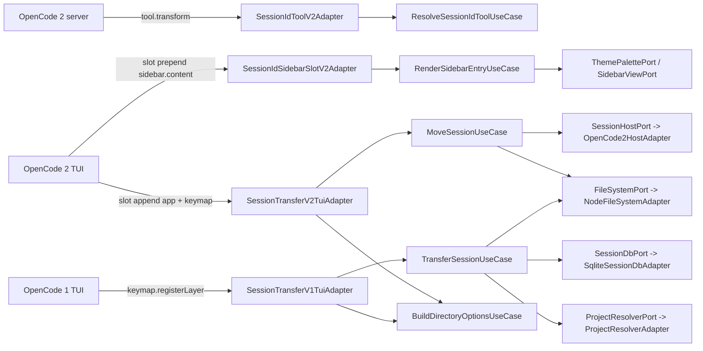

# opencode-session-manager

An OpenCode plugin for working with sessions. It replaces two earlier plugins,
`opencode-session-id` and `opencode-sessions-transfer`, whose histories are
merged into this repository.

1. **Session ID in the sidebar** — the active session's ID is the first row of
   the session sidebar, directly under the title, in the theme's muted colour.
2. **The `session-id` tool** — returns the running session's ID to the agent.
3. **`/transfer-session`** (alias `/relocate`, palette "Transfer session") —
   moves a session to any folder: another project, a plain folder, or a folder
   that does not exist yet (it is created).

```
┌ sidebar ─────────────────────────────┐
│ <session title>                      │
│                                      │
│ ses_0123456789abCDEFGHIJKLMNOP       │  ← prepend on sidebar.content
│ Context …                            │
```

## OpenCode compatibility

| Host | Tested plugin SDK | Features | Built entrypoints |
|---|---|---|---|
| OpenCode 2 (2.0.14 contract; verified on 2.0.24) | `@opencode/plugin@2.0.14` | all three | `dist/v2/server.js`, `dist/v2/tui.js` |
| OpenCode 1.18.32 | `@opencode-ai/plugin@1.18.32` | `/transfer-session` | `dist/v1/session-manager.js`, `dist/v1/session-manager.tui.js` |

### OpenCode 2

- `dist/v2/server.js` registers the `session-id` tool.
- `dist/v2/tui.js` prepends the ID line to `sidebar.content` and registers
  `/transfer-session` from an `app` slot (where `keymap.layer` runs in-tree).
  Its cleanup removes both.

The move goes through the host's `session.move` API — no database writes — so
the host re-resolves the project and tells the agent about the new directory.
Over the built-in `/cd` and `/worktrees`, the plugin adds a picker over every
project root, worktree and session directory across projects, moving a session
other than the open one, and creating a destination that does not exist yet.

### OpenCode 1

v1 has no session-move API, so `/transfer-session` writes the v1 SQLite store
directly and resolves the destination project exactly as the v1.18.32 host does
(`sha1("git-remote:<host>/<path>")` of `origin`, else the id cached in
`<git-common-dir>/opencode`, else the first root commit, else `global`), then
leaves a synthetic reminder so the agent adopts the new directory.

## What it can and cannot do

- The title box has no plugin slot, so the ID is the first row of the sidebar's
  scroll area and scrolls with the sidebar content. No OpenCode setting
  (`opencode.jsonc` or `cli.json`) shows the session ID.
- The sidebar only appears when the terminal is wide enough
  (`session.sidebar: "auto"` in `cli.json`).
- The transfer dialog cannot autocomplete paths live or drill into folders with
  the arrow keys: the plugin dialog API exposes no filter handle or bindings. It
  lists every known directory instead, plus "Enter custom path…" (`~` works).

## Install

```
bun install --frozen-lockfile
bun run install:plugin:v2      # or install:plugin:v1 for an OpenCode 1 host
```

The v2 installer builds, then writes the folder `<plugins>/session-manager/`
(`server.js`, `tui.js`); the v1 installer writes `session-manager.js` and
`session-manager.tui.js`. `<plugins>` is `OPENCODE_V2_PLUGIN_DIR` /
`OPENCODE_V1_PLUGIN_DIR`, else `$XDG_CONFIG_HOME/opencode/plugins` (default
`~/.config/opencode/plugins`), where the host auto-discovers it. Either lane
removes the other lane's files and those of the two plugins this one replaces
(`session-id/`, `sessions-transfer/`, `sessions-transfer{,.tui}.js`). No
configuration is written. A running v2 host activates the plugin as soon as it
lands; restart the TUI to see the sidebar line.

## Architecture

Strict hexagonal, dependencies point inward only; the full contract is in
`AGENTS.md`. There is one composition root per host runtime, because the
entrypoints load into different processes.



Composition roots: `src/main/server-container.ts` (v2 server),
`src/main/tui-container.ts` (v2 TUI), `src/main/v1-container.ts` (v1 TUI).
Entrypoints: `src/main/v2/server.ts`, `src/main/v2/tui.ts`,
`src/main/v1/server.ts`, `src/main/v1/tui.ts`. `scripts/build.mjs` binds the v2
TUI bundle to the host's shared Solid/OpenTUI runtime.

## Build and test

```
bun run typecheck
bun run test
bun run coverage
bun run lint:diagrams
```

The four tiers live under `tests/{unit,component,e2e,live}`:

- **unit** — one class at a time with stand-ins, plus the architecture, SOLID,
  host-fixture and coverage-completeness gates. Coverage-gated.
- **component** — the wired plugin painted by the real OpenTUI renderer, and the
  tool's parity with the hand-written plugin it replaced.
- **e2e** — the real entries in-process: the v2 TUI loaded by the real 2.0.14
  `Host`, the v1 entries over a real SQLite store and real git repositories.
  Coverage-gated.
- **live** — the real `opencode` executable, the built bundles, the installer,
  and the real TUI in a pseudo-terminal (sidebar line and `/transfer-session`),
  all under isolated XDG directories. Invisible to coverage by construction.

`bun run coverage` requires 100 % lines and functions on every `src` file, in the
unit and the e2e tier separately. The live tier needs `node` (for the
pseudo-terminal) and finds OpenCode at `OPENCODE_V2_EXECUTABLE`, else
`~/.opencode/bin/opencode` (`~/.local/bin/opencode.exe` on Windows), else `PATH`.

## License

MIT © mavasbel
