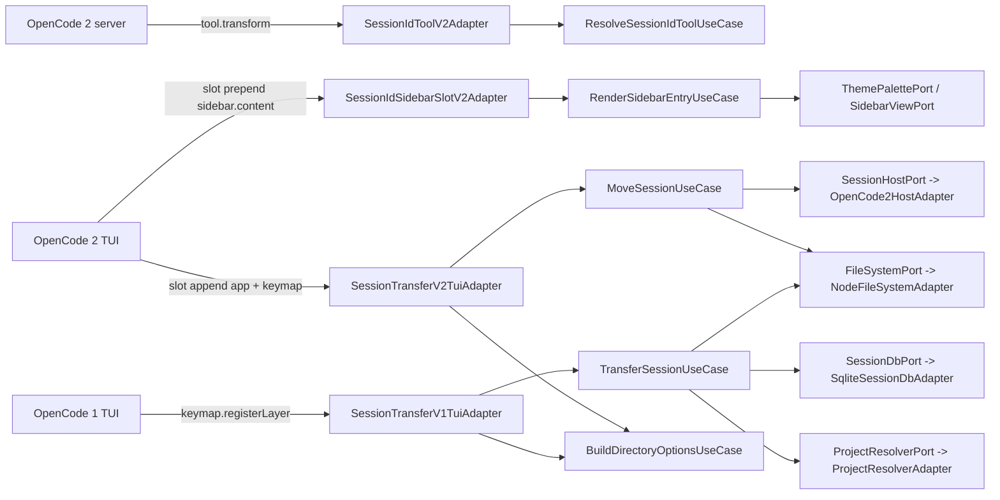
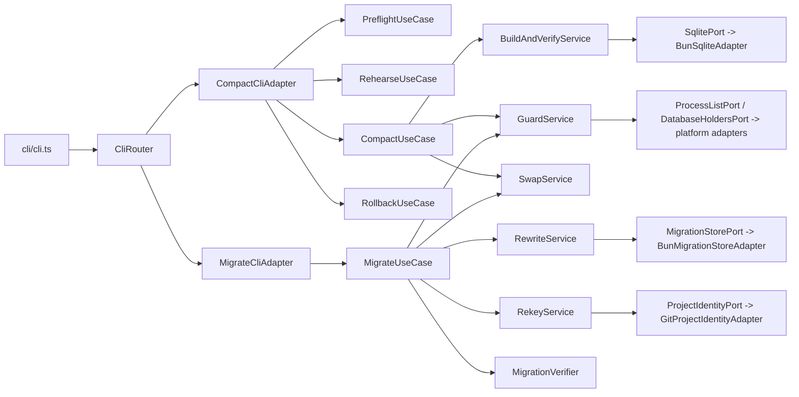

# opencode-session-manager

Tools for working with OpenCode sessions, in two parts:

- **an OpenCode plugin**, used inside OpenCode (below);
- **an offline maintenance CLI**, `opencode-session-manager`, for an OpenCode 2
  `opencode.db` while OpenCode is closed: verified compaction and migration of
  sessions from another machine, each with a rename-only swap and a rollback
  (see [Offline maintenance CLI](#offline-maintenance-cli)).

It replaces three earlier projects, `opencode-session-id`,
`opencode-sessions-transfer` and `opencode-db-manager` (formerly
`opencode-db-compact`), whose histories are merged into this repository.

The plugin:

1. **Session ID in the sidebar** — the active session's ID is the first row of
   the session sidebar, directly under the title, in the theme's muted colour.
2. **The `session-id` tool** — returns the running session's ID to the agent.
3. **`/transfer-session`** (alias `/relocate`, palette "Transfer session") —
   moves a session to any folder: another project, a plain folder, or a folder
   that does not exist yet (it is created).

```
┌ sidebar ─────────────────────────────┐
│ <session title>                      │
│                                      │
│ ses_0123456789abCDEFGHIJKLMNOP       │  ← prepend on sidebar.content
│ Context …                            │
```

## OpenCode compatibility

| Host | Tested plugin SDK | Features | Built entrypoints |
|---|---|---|---|
| OpenCode 2 (2.0.14 contract; verified on 2.0.24) | `@opencode/plugin@2.0.14` | all three | `dist/v2/server.js`, `dist/v2/tui.js` |
| OpenCode 1.18.32 | `@opencode-ai/plugin@1.18.32` | `/transfer-session` | `dist/v1/session-manager.js`, `dist/v1/session-manager.tui.js` |

### OpenCode 2

- `dist/v2/server.js` registers the `session-id` tool.
- `dist/v2/tui.js` prepends the ID line to `sidebar.content` and registers
  `/transfer-session` from an `app` slot (where `keymap.layer` runs in-tree).
  Its cleanup removes both.

The move goes through the host's `session.move` API — no database writes — so
the host re-resolves the project and tells the agent about the new directory.
Over the built-in `/cd` and `/worktrees`, the plugin adds a picker over every
project root, worktree and session directory across projects, moving a session
other than the open one, and creating a destination that does not exist yet.

### OpenCode 1

v1 has no session-move API, so `/transfer-session` writes the v1 SQLite store
directly and resolves the destination project exactly as the v1.18.32 host does
(`sha1("git-remote:<host>/<path>")` of `origin`, else the id cached in
`<git-common-dir>/opencode`, else the first root commit, else `global`), then
leaves a synthetic reminder so the agent adopts the new directory.

## What it can and cannot do

- The title box has no plugin slot, so the ID is the first row of the sidebar's
  scroll area and scrolls with the sidebar content. No OpenCode setting
  (`opencode.jsonc` or `cli.json`) shows the session ID.
- The sidebar only appears when the terminal is wide enough
  (`session.sidebar: "auto"` in `cli.json`).
- The transfer dialog cannot autocomplete paths live or drill into folders with
  the arrow keys: the plugin dialog API exposes no filter handle or bindings. It
  lists every known directory instead, plus "Enter custom path…" (`~` works).

## Install

```
bun install --frozen-lockfile
bun run install:plugin:v2      # or install:plugin:v1 for an OpenCode 1 host
```

The v2 installer builds, then writes the folder `<plugins>/session-manager/`
(`server.js`, `tui.js`); the v1 installer writes `session-manager.js` and
`session-manager.tui.js`. `<plugins>` is `OPENCODE_V2_PLUGIN_DIR` /
`OPENCODE_V1_PLUGIN_DIR`, else `$XDG_CONFIG_HOME/opencode/plugins` (default
`~/.config/opencode/plugins`), where the host auto-discovers it. Either lane
removes the other lane's files and those of the two plugins this one replaces
(`session-id/`, `sessions-transfer/`, `sessions-transfer{,.tui}.js`). No
configuration is written. A running v2 host activates the plugin as soon as it
lands; restart the TUI to see the sidebar line.

## Offline maintenance CLI

`opencode-session-manager` works on the database itself, so it runs only while
every OpenCode process is closed (`opencode service stop` too, if the service
runs). It never kills a process: it refuses while OpenCode runs or while any
process holds the database open, and names the holders on Linux.

```
bun run build                                   # dist/cli/opencode-session-manager (.exe on Windows)
opencode-session-manager preflight              # read-only: sizes, page statistics, free disk, running OpenCode
opencode-session-manager rehearse [--keep]      # build a compacted copy and verify it
opencode-session-manager run                    # guard, build, verify, swap, write evidence
opencode-session-manager rollback <backupDir>   # put the originals back
opencode-session-manager migrate <rehearse|run> --from <db>... --windows-user <name> \
  [--drive C] [--mount <dir>]... [--relocate <from>=<to>]... [--home <dir>] [--keep]
```

`sessions` is read-only and safe while OpenCode runs; the other commands need it
closed:

```
opencode-session-manager sessions [--data <dataHome>] [--json]
```

It lists one **profile** — an OpenCode installation's `opencode/opencode.db` and,
when Magic Context is installed, its `cortexkit/magic-context/context.db`, both
under one XDG data home (`--data`, default `$XDG_DATA_HOME` or
`~/.local/share`) — newest session first, with each session's entry count and
what Magic Context holds for it (history summaries, tags, notes, memories it
created). A Windows profile on an NTFS-compressed mount cannot be read in place;
copy its stores to a Linux filesystem first.

From a checkout, `bun run cli -- <arguments>` runs the same thing. The database
defaults to `$XDG_DATA_HOME/opencode/opencode.db`
(`~/.local/share/opencode/opencode.db` when unset); `--db <path>` overrides it.

### Compaction

OpenCode never compacts its database and SQLite's auto-compaction is off, so a
database that has seen a lot of deletion keeps every freed page. The compacted
copy is made with `VACUUM INTO` from a read-only connection, so the source is
never written, then checked six ways (integrity, foreign keys, zero free pages,
per-table row parity, WAL journal mode, no leftover sidecars). Only then is it
swapped in by renames: the original database and its sidecars move into
`db-backup-<timestamp>/` and stay there. Any failure aborts before the swap and
keeps the failed copy for inspection.

- `run` refuses while the process named by `OPENCODE_DB_COMPACT_IMAGE` (default
  `opencode`, `opencode.exe` on Windows) runs, while any process holds the
  database or a sidecar open, or when there is no room for two copies.
- `rehearse` works in `OPENCODE_DB_COMPACT_REHEARSAL_DIR` (default
  `<temp>/opencode/compact-rehearsal`) and writes `report-<timestamp>.json`
  there; `--keep` keeps the copy. `run` keeps its evidence in
  `db-backup-<timestamp>/report.json`.

### Migration from a Windows machine

`migrate` merges another machine's sessions into the local database, with every
Windows profile path rewritten to this home, so each session shows up under its
folder here as if it had been started on this machine.

1. **Copy** the local database and every `--from` database with `VACUUM INTO`;
   nothing below touches an original.
2. **Rewrite** every text cell except the credential tables and OpenCode's
   migration log: `C:\Users\<user>`, `C:/Users/<user>`, the same escaped once,
   twice or three times inside nested JSON, `file:///C:/…`, `@fs/C:/…`,
   `/mnt/c/…`, `/cygdrive/c/…`, `/c/…`, the drive's mount folder here (`--mount`),
   and the `Users/<user>` form stored below the root project. Only matched paths
   change, so JSON stays byte-identical otherwise. `--relocate <from>=<to>` then
   moves folders that live elsewhere here.
3. **Merge** source rows whose primary key is absent; the local row wins.
4. **Re-key** every session onto the project id OpenCode derives for its folder
   here (`sha1("git-remote:" + host/path)` for a repository with a remote, else
   its stored id, else its root commit; `sha1("directory:" + realpath)` for a
   plain folder), and recompute `session.path`. A session whose folder is missing
   keeps its project and is listed in the report.
5. **Verify** seven gates (integrity, foreign keys, rows kept, no Windows session
   folder, clean folder columns, consistent subpaths, intact JSON), then **swap**
   (`run` only) exactly as compaction does. `rollback` undoes it.

`migrate rehearse` works in `OPENCODE_DB_MIGRATE_REHEARSAL_DIR` (default
`<temp>/opencode/migrate-rehearsal`). A Windows `opencode.db` on an NTFS
partition is often NTFS-compressed, which Linux's `ntfs3` driver cannot open for
SQLite: copy the `.db`, `-wal` and `-shm` files to a Linux filesystem first.

## Architecture

Strict hexagonal, dependencies point inward only; the full contract is in
`AGENTS.md`. There is one composition root per host runtime, because the
entrypoints load into different processes.



The CLI has its own composition root, `src/main/cli-container.ts`, plus one
per operating system (`src/main/linux-container.ts`, `src/main/win32-container.ts`),
loaded on demand by `src/main/cli/platform.ts`:



Composition roots: `src/main/server-container.ts` (v2 server),
`src/main/tui-container.ts` (v2 TUI), `src/main/v1-container.ts` (v1 TUI).
Entrypoints: `src/main/v2/server.ts`, `src/main/v2/tui.ts`,
`src/main/v1/server.ts`, `src/main/v1/tui.ts`. `scripts/build.mjs` binds the v2
TUI bundle to the host's shared Solid/OpenTUI runtime.

## Build and test

```
bun run typecheck
bun run test
bun run coverage
bun run lint:diagrams
```

The four tiers live under `tests/{unit,component,e2e,live}`:

- **unit** — one class at a time with stand-ins, plus the architecture, SOLID,
  platform, host-fixture and coverage-completeness gates. Coverage-gated.
- **component** — the wired plugin painted by the real OpenTUI renderer, the
  tool's parity with the hand-written plugin it replaced, and real SQLite
  compacting and migrating real databases over real folders and git repositories.
- **e2e** — the real entries in-process: the v2 TUI loaded by the real 2.0.14
  `Host`, the v1 entries over a real SQLite store and real git repositories, and
  the CLI's container over real databases, including a same-behaviour comparison
  with the frozen original compactor (`tests/support/maintenance/fixtures/legacy/`).
  Coverage-gated, per platform.
- **live** — the real `opencode` executable, the built bundles, the installer,
  and the real TUI in a pseudo-terminal (sidebar line and `/transfer-session`),
  all under isolated XDG directories; for the CLI, a read-only snapshot of the
  real `opencode.db` through preflight, a full run and a rollback, and (when
  `OPENCODE_DB_MIGRATE_LIVE_SOURCE` and `OPENCODE_DB_MIGRATE_LIVE_USER` name a
  Windows database and user) a real migration rehearsal listed by a sandboxed
  OpenCode. Invisible to coverage by construction.

`bun run coverage` requires 100 % lines and functions on every `src` file, in the
unit and the e2e tier separately. The e2e gate is per platform: each platform's
run gates every file except the other platforms' adapters and containers. The live tier needs `node` (for the
pseudo-terminal) and finds OpenCode at `OPENCODE_V2_EXECUTABLE`, else
`~/.opencode/bin/opencode` (`~/.local/bin/opencode.exe` on Windows), else `PATH`.

## License

MIT © mavasbel
