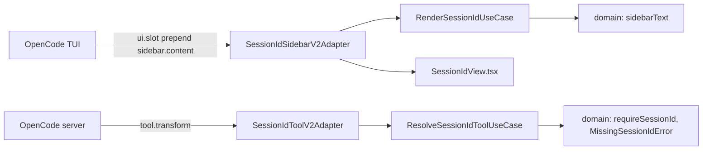

# opencode-session-id

OpenCode 2.0.14 plugin that:

1. shows the active session ID in the session sidebar, as the first row under
   the session title (muted colour);
2. provides the `session-id` tool, identical to the hand-written
   `v2-plugins/session-id/index.js` it replaces.

```
┌ sidebar ─────────────────────────────┐
│ <session title>                      │
│                                      │
│ ses_f21822cb5ffeVVFa0ptiLeWfax       │  ← this plugin (prepend on sidebar.content)
│ Context …                            │
```

## What it can and cannot do

- The title box has no plugin slot. The ID is the first row of the sidebar's
  scroll area, so it scrolls with the sidebar content.
- The sidebar only appears when the terminal is wide enough (`session.sidebar: "auto"`).
- OpenCode 1.x is not supported.

## Build and test

```
bun install --frozen-lockfile
bun run typecheck
bun run test
bun run coverage
bun run test:live
bun run lint:diagrams
```

`bun run test` includes end-to-end tests against the real `opencode.exe` 2.0.14
in fully isolated config/data folders with a local mock model provider. The
model calls `session-id` and the test checks that the result equals the new
session's ID. `bun run test:live` starts the real TUI in a Windows pseudo-terminal
(200×50) and checks that the ID is rendered in the sidebar, directly under the
title and one blank row.

## Install

Installers never edit `opencode.jsonc`.

```
set OPENCODE_V2_PLUGIN_ROOT=C:\Users\Marco\.config\opencode\v2-plugins
bun run install:plugin:v2
set OPENCODE_V2_RELEASE_DIRECTORY=<release path printed by the previous step>
bun run validate:installed:v2
bun run shims:installed:v2
```

`shims:installed:v2` copies any existing `session-id\index.js` / `tui.js` into
`session-id\backup-<timestamp>\`, then writes two one-line files:

- `session-id\index.js` → `export { default } from "file:///…/releases/sha256-…/server.js"`
- `session-id\tui.js` → `export { default } from "file:///…/releases/sha256-…/tui.js"`

The `session-id` folder is already in the `plugins` list of the user's
`opencode.jsonc`, so no configuration change is needed. Restart OpenCode to load it.

**Rollback:** copy `backup-<timestamp>\index.js` back to `session-id\index.js`
and delete `session-id\tui.js`.

## Architecture

Hexagonal, inward-only dependencies; see `AGENTS.md` for the full contract.



Key files:

- `src/infrastructure/adapters/inbound/tui/SessionIdSidebarV2Adapter.ts`
- `src/infrastructure/adapters/inbound/tui/SessionIdView.tsx`
- `src/infrastructure/adapters/inbound/server/SessionIdToolV2Adapter.ts`
- `src/main/container.ts`
- `scripts/build.mjs` — binds the TUI bundle to the host's shared Solid/OpenTUI runtime

## License

MIT © mavasbel
