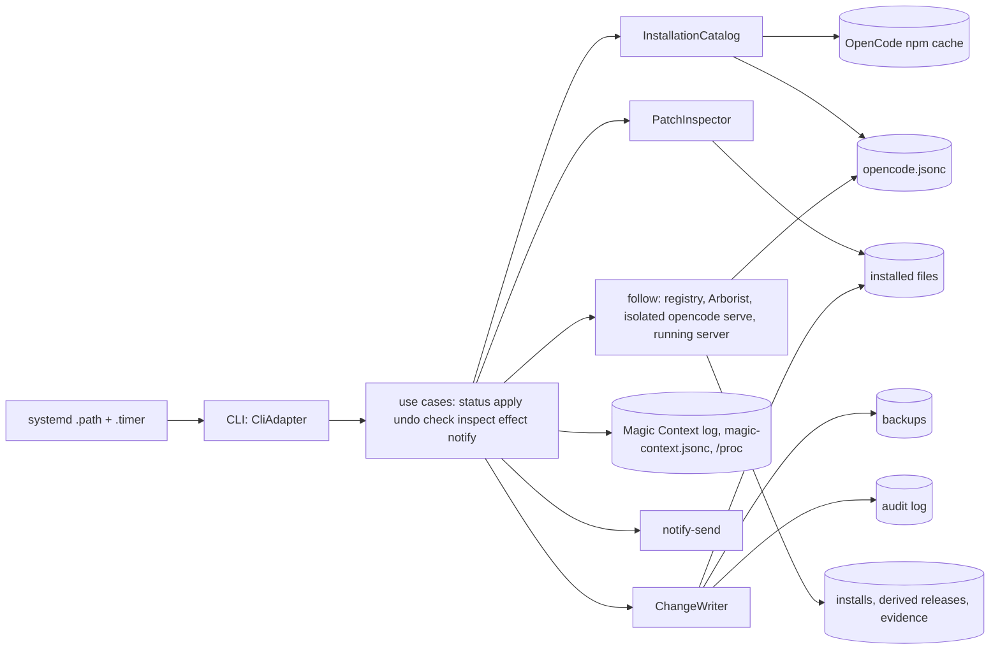

# opencode-magic-context-patches

Local, auditable patches for the [Magic Context](https://github.com/cortexkit/magic-context) plugin
that OpenCode installs, re-runnable after every Magic Context update.

Each patch is written down once, in `patches/`, with the exact files it changes, the text it replaces,
how many times, and the sha256 of each file before and after — for every Magic Context version it has
been checked against. The tool changes a file only when it is exactly the recorded original and the
result is exactly the recorded patched file; it keeps a backup of every original, writes every action
to an audit log, and can put everything back.

`follow` goes one step further: when npm publishes a new Magic Context, it installs that release into
a folder of its own, finds each patch's sites by content (a matcher per patch), patches the copy,
proves it in an isolated `opencode serve`, and only then points the one Magic Context entry of
`opencode.jsonc` at that folder. OpenCode reloads it without a restart, so it never loads an unpatched
copy. Any doubt — an unknown shape of a site, a rejected setting, a server that does not reload — stops
it, and OpenCode keeps what it loaded.
A file may belong to more than one patch: patches are applied in `patches/index.ts` order, each
matcher reading the file the previous patch left, so the later release's `before` is the earlier
release's `after`. A patch whose site upstream introduced (or dropped) leaves `optional: true` on its
matcher: on a release that holds none of its sites it has nothing to change and does not stop
`follow` (a file holding only some of its sites still stops it).

Linux only (it reads `/proc`, and the watch uses systemd user units). Local repository, not published.

## The patches

| Patch | What it changes | Why | Checked versions |
|---|---|---|---|
| `execute-threshold-min` | The configuration minimum of `execute_threshold_percentage`: `min(20).max(90` → `min(1).max(90` (3 places in each of 2 files) | Magic Context rejects a configured `13` ("invalid value (number 13), using default 65") although the code that uses the threshold has no lower limit. Evidence: `docs/reference/2026-10-11-19-37-magic-context-0.47.0-execute-threshold.md`, `docs/reference/2026-10-12-15-13-magic-context-0.48.0-execute-threshold.md`, `docs/reference/2026-10-12-23-15-magic-context-0.49.0-execute-threshold.md`, `docs/reference/2026-10-14-22-08-magic-context-0.49.2-execute-threshold.md`, `docs/reference/2026-10-16-17-03-magic-context-0.49.7-execute-threshold.md`, `docs/reference/2026-10-18-11-42-magic-context-0.49.12-execute-threshold.md`, `docs/reference/2026-10-19-16-03-magic-context-0.49.13-execute-threshold.md`, `docs/reference/2026-10-20-20-57-magic-context-0.49.15-execute-threshold.md`, `docs/reference/2026-10-22-23-00-magic-context-0.49.19-patches.md`, `docs/reference/2026-11-02-06-30-magic-context-0.49.35-patches.md`, `docs/reference/2026-11-07-23-41-magic-context-0.49.41-patches.md`, `docs/reference/2026-11-08-10-45-magic-context-0.49.42-0.49.43-patches.md` | 0.47.0, 0.48.0, 0.49.0, 0.49.2, 0.49.7, 0.49.12, 0.49.13, 0.49.15, 0.49.19, 0.49.35, 0.49.41, 0.49.42, 0.49.43, 0.49.50, 0.49.55, 0.49.56 |
| `no-session-model-fallback` | The historian's retry chain: `...args.fallbackModelId ? [{ model: args.fallbackModelId }] : []` → `...[] /* mc-patches: no-session-model-fallback */` (1 place in each of 2 files; from 0.49.19 the text is `...!primary && args.fallbackModelId ? [{ model: args.fallbackModelId }] : []`) | After every configured model failed, the historian retried once on the summarised session's own model, which no setting turns off; it ran Claude and a paid model while only free models were configured. Evidence: `docs/reference/2026-10-22-01-14-magic-context-0.49.15-no-session-model-fallback.md`, `docs/reference/2026-10-22-23-00-magic-context-0.49.19-patches.md`, `docs/reference/2026-11-02-06-30-magic-context-0.49.35-patches.md`, `docs/reference/2026-11-07-23-41-magic-context-0.49.41-patches.md`, `docs/reference/2026-11-08-10-45-magic-context-0.49.42-0.49.43-patches.md` | 0.49.15, 0.49.19, 0.49.35, 0.49.41, 0.49.42, 0.49.43, 0.49.50, 0.49.55, 0.49.56 |
| `refusal-recovery` | Five sites, each once in each of 2 files (3 files in all): the historian wait is no longer clamped to 60 s, so `historian_timeout_ms` applies (`return Math.max(0, Math.min(requested, HISTORIAN_INLINE_JOIN_BUDGET_MS));` → `return Math.max(0, requested);`); the "may take up to … seconds" notice states that wait; `EmergencyFailClosedError` gets the error toast the other blocking errors get; after such a refusal the session runs the first-pass reset again (usage measured anew) | With a historian slower than 60 s, a turn was interrupted before the provider request whatever `historian_timeout_ms` said, and the user saw no reason; the next turns could reuse the reading that caused the refusal ([cortexkit/magic-context#828](https://github.com/cortexkit/magic-context/issues/828)). Evidence: `docs/reference/2026-11-02-23-06-magic-context-0.49.35-refusal-patches.md`, sandbox before/after `docs/reference/2026-11-03-01-43-magic-context-0.49.35-refusal-recovery-sandbox.md`, `docs/reference/2026-11-07-23-41-magic-context-0.49.41-patches.md`, `docs/reference/2026-11-08-10-45-magic-context-0.49.42-0.49.43-patches.md`, `docs/reference/2026-11-11-01-24-magic-context-0.49.46-0.49.50-patches.md`, `docs/reference/2026-11-14-18-33-magic-context-0.49.51-0.49.55-patches.md` | 0.49.35, 0.49.41, 0.49.42, 0.49.43, 0.49.50, 0.49.55, 0.49.56 |
| `fold-identity-stable` | The store identity, once in each of 2 files: `${stat.dev}:${stat.ino}:${stat.birthtimeMs}` → `${stat.ino}:${stat.birthtimeMs}`, in `const acquiredIdentity = identity || …` and `const identity = …` | Magic Context hashes the identity into `proof.sourceDigest` of every fold admission; btrfs gives `st_dev` a new anonymous number at every boot, so every admission stops matching, every transform refuses its own checkpoint (`v3 host fold: replay refused: invalid checkpoint floor or provenance`, 1 171 lines in 7 sessions on 2026-11-10) and the native fold is rebuilt instead of reused. Evidence: `docs/reference/2026-11-10-23-00-magic-context-fold-identity.md` | 0.49.15, 0.49.50, 0.49.55, 0.49.56 |
| `fold-provenance-heal` | The admission guard, once in each of 2 files: a `proof.sourceDigest` that no longer matches while the checkpoint id and the summary digest do rewrites the admission with the current digest and reports `replay provenance refreshed after the store identity changed`; the other two mismatches keep their refusal | An admission written under another mount can never repair itself, because the plugin refuses the fold it would have to rewrite — with `fold-identity-stable` this heals the admissions stored before it, once per session, instead of a rebuild on every transform. Evidence: `docs/reference/2026-11-10-23-00-magic-context-fold-identity.md` | 0.49.50, 0.49.55, 0.49.56 |

## Install

```sh
cd ~/Dev/repos/devtools/opencode-magic-context-patches
bun install
bun run install:cli     # builds and installs ~/.local/bin/opencode-magic-context-patches (checks the copy)
bun run install:watch   # systemd user units that run `follow` on updates, after login and every 6 hours
```

`bun run validate:installed:cli` checks the installed program is byte-identical to the build and
answers `--version`; `bun run validate:watch` checks the units are installed, valid, enabled and
active; `bun run uninstall:watch` removes them. `OPENCODE_MC_PATCHES_BIN_DIR` installs the program
elsewhere; `OPENCODE_MC_PATCHES_SYSTEMD_DIR` puts the units elsewhere. From a checkout without
installing: `bun run cli -- <command>`.

The committed units stay host-neutral: they rely on the program's defaults
(`~/.opencode/bin/opencode` and `notify-send`). A host that installs OpenCode elsewhere, or wants no
notifier, sets `OPENCODE_MC_PATCHES_OPENCODE_BIN` and `OPENCODE_MC_PATCHES_NOTIFY_BIN` in a systemd
drop-in under `~/.config/systemd/user/opencode-magic-context-patches.service.d/` instead of editing
the shared unit.

## Commands

```text
opencode-magic-context-patches status  [--json]
opencode-magic-context-patches apply   [--patch <id>] [--version <v>] [--json]
opencode-magic-context-patches undo    [--patch <id>] [--version <v>] [--json]
opencode-magic-context-patches check   [--json]
opencode-magic-context-patches inspect --version <v> [--json]
opencode-magic-context-patches effect  [--since <ISO time>] [--json]
opencode-magic-context-patches notify  [--json]
opencode-magic-context-patches follow  [--version <v>] [--json]
opencode-magic-context-patches follow  --rollback [--json]
opencode-magic-context-patches --help | --version
```

| Command | Does | Changes files? | Exit code |
|---|---|---|---|
| `status` | Every installed Magic Context copy (which one `opencode.jsonc` pins is marked `LOADED`), and each patch on it: `applied`, `not-applied`, `partial`, `changed` (a file matches neither checksum), `missing-file`, or `unchecked-version` | no | 0 |
| `apply` | Applies every patch to the loaded copy (or to the copies of `--version`). Each file must be the recorded original; the result must have the recorded checksum; the original is backed up first; the file is replaced in one step (written beside it, renamed over it, mode kept) and read back. If anything fails, every file it already wrote is put back. Running it again changes nothing. | yes | 1 if anything was refused or failed |
| `undo` | Puts the originals back: from the backup when it is intact, otherwise by reversing the replacements — either way only if the result has the recorded original checksum | yes | 1 if refused or failed |
| `check` | Passes only if every patch is applied on the copy OpenCode loads | no | 1 if not |
| `inspect` | For a version a patch has not been checked against: where the replaced text occurs in that version's `dist/**/*.js`, how often, whether each file is the same as in the checked version, with context, for a person to review before adding the version to the patch | no | 0 |
| `effect` | Reads Magic Context's own log since the OpenCode server started (or `--since`): how often `execute_threshold_percentage` was rejected, which proactive floor was logged, and so which threshold is really in use, against the configured one | no | 0 only if `respected` |
| `notify` | Runs `check`; when it fails, shows a desktop notification (`notify-send`), once per distinct problem | no | 1 if `check` fails |
| `follow` | Adopts npm `latest` (or `--version <v>`, even an older one) already patched; see [follow](#follow). Prints every step with its time and what it found. | a new install folder, and the one Magic Context entry of `opencode.jsonc` | 0 if `adopted` or `up-to-date`, 1 if `stopped` or `busy` |
| `follow --rollback` | Puts back the entry `opencode.jsonc` had before the last adoption (or rollback) and confirms the running server reloaded it | the one Magic Context entry of `opencode.jsonc` | 0 if `rolled-back` |

Where things are kept:

| What | Where |
|---|---|
| Backups (read-only, one per original, named by checksum) | `<XDG_DATA_HOME>/opencode-magic-context-patches/backups/<version>/<patch>/<path>@<sha256>` (default `~/.local/share/…`) |
| Audit log (one JSON line per file per `apply`/`undo`, including refusals: time, user, pid, version, file, checksums before/after, outcome, backup, reason) | `<XDG_STATE_HOME>/opencode-magic-context-patches/audit.log` (default `~/.local/state/…`, mode 600) |
| Last notification sent | `<XDG_STATE_HOME>/opencode-magic-context-patches/last-notification` (`notify`), `last-follow-notification` (`follow`) |
| Patched copies `follow` installed (the adopted one, and the one the previous entry names) | `<XDG_DATA_HOME>/opencode-magic-context-patches/installs/<version>/node_modules/@cortexkit/opencode-magic-context` |
| Releases `follow` derived (checksums `status`, `apply` and `undo` use for unreviewed versions) | `<XDG_DATA_HOME>/opencode-magic-context-patches/derived-releases.json` |
| Evidence of each adoption (every step, every patched file with both checksums) | `<XDG_STATE_HOME>/opencode-magic-context-patches/evidence/YYYY-MM-DD-HH-MM-magic-context-<v>-follow.md` |
| Backups of `opencode.jsonc` before each entry change | `<XDG_DATA_HOME>/opencode-magic-context-patches/backups/config/follow/opencode.jsonc@<sha256>` |
| The entry `follow --rollback` restores | `<XDG_STATE_HOME>/opencode-magic-context-patches/follow-previous-entry` |
| The lock one `follow` run holds | `<XDG_STATE_HOME>/opencode-magic-context-patches/follow.lock` (holds its pid; taken over when that process is gone) |

What it reads: Magic Context installations under `<XDG_CACHE_HOME>/opencode/npm/@cortexkit/opencode-magic-context@<spec>/`
(OpenCode 2.0.24 puts the package one numbered folder further down) and the ones `follow` installed; the
pinned spec (or folder) from `<XDG_CONFIG_HOME>/opencode/opencode.jsonc`; the configured threshold from
`<XDG_CONFIG_HOME>/cortexkit/magic-context.jsonc`; Magic Context's log at `MAGIC_CONTEXT_LOG_PATH`,
else `<TMPDIR or /tmp>/opencode2/magic-context/magic-context.log` (Magic Context's own rule); the
OpenCode server's start time from `/proc` (`OPENCODE_MC_PATCHES_PROC` points elsewhere, for tests).
`OPENCODE_MC_PATCHES_NOTIFY_BIN` replaces `notify-send`. For `follow`: `OPENCODE_MC_PATCHES_REGISTRY`
(default `https://registry.npmjs.org`), npm's cache `~/.npm/_cacache`, `OPENCODE_MC_PATCHES_OPENCODE_BIN`
(default `~/.opencode/bin/opencode`, for the isolated server), the running service's address and
password from `<XDG_STATE_HOME>/opencode/service.json`, `OPENCODE_MC_PATCHES_TIMEOUT_MS` (each wait,
default 120000) and `OPENCODE_MC_PATCHES_SETTLE_MS` (the wait before a log is read, default 5000).



## follow

| Step | What it does | Stops when |
|---|---|---|
| detect | npm `dist-tags.latest` (or `--version`) and its tarball integrity; compares with the copy OpenCode loads | not newer (`up-to-date`), no entry in `opencode.jsonc`, the registry fails, the version was never published, or the running server still loads an old folder of that version |
| stage | Installs it with `@npmcli/arborist` 9.4.0 and OpenCode 2.1.1's own options into `installs/.staging-<v>-<uuid>/` (8,410 files for 0.49.19, byte-identical to OpenCode's own install); the installed version and integrity must be the registry's | install failure, another version, another integrity |
| locate | Each patch's matcher reads every `dist/**/*.js` for each of its sites: exactly 2 files must hold a known shape of the site, each exactly its count of times (3 × `min(20).max(90`; 1 × the 0.49.15 or the 0.49.19 fallback spread; 1 × each of `refusal-recovery`'s five texts), each hit within its site's window after its anchor (300 characters after `execute_threshold_percentage` and after `async function runFallbackHistorianPass(args) {`; 150 to 400 for `refusal-recovery`, see `patches/refusal-recovery.ts`), no replacement already present, no file changed by two patches | any other count, file count, shape or anchor |
| patch | Replaces the text, checks every changed bundle still parses (Bun's parser), writes it and reads it back; a reviewed version must give exactly its reviewed checksums; then renames the folder to `installs/<v>/` | parse error, read-back mismatch, a reviewed checksum differs |
| prove | An isolated `opencode serve --port 0` (its own HOME, XDG folders and TMPDIR; nothing else from the environment) with the user's `magic-context.jsonc` and that folder as its only plugin: the plugin must be `active`, loaded from that folder, and Magic Context's log must hold no `config reload failed` | anything else; the folder is removed |
| publish | Backs up `opencode.jsonc`, replaces only the Magic Context string with the folder (comments and layout kept), reads it back | not exactly one entry, read-back mismatch |
| confirm | Waits until every location of the running OpenCode server reports the plugin `active` from that folder (OpenCode watches its configuration; nothing restarts), then reads Magic Context's log from the switch: no `config reload failed`, and the threshold in use must not differ from the configured one | timeout or rejection: the previous entry is put back and confirmed |
| record | Keeps the derived releases, removes older installs nothing names or loads, appends the audit log, writes the evidence document, remembers the previous entry for `--rollback`, notifies | – |

A stopped run is audited and notified once per distinct reason. Versions adopted this way show as
`(auto-checked by follow)` in `status` until a person adds them to `patches/` (with fixtures).

## After a Magic Context update

The watch (`bun run install:watch`) runs `follow` when OpenCode adds a folder under
`~/.cache/opencode/npm/@cortexkit/` or `opencode.jsonc` changes (after 30 s, to let the install
finish), 2 minutes after login, and every 6 hours. With a new release on npm it adopts it already
patched; otherwise it reports `up-to-date`. Changes that happen while a run is already waiting are
covered by that run (systemd does not queue a second one); the 6-hour timer catches anything else.
`follow` changing `opencode.jsonc` triggers one more run, which finds nothing to do.

When `follow` stopped (a notification says on which step), or for an npm pin you changed by hand:

1. `opencode-magic-context-patches status`. If the new version shows `not-applied`, it has been
   checked: run `apply`, then restart OpenCode.
2. If it shows `unchecked-version`, run `opencode-magic-context-patches inspect --version <v>` and
   review where the text now is. When it is safe, add a release for that version to the patch in
   `patches/` (from the published npm tarball: `before` and `after` checksums, counts), add a fixture
   under `tests/fixtures/magic-context-<v>/`, run `bun run check`, commit, `bun run install:cli`,
   then `apply`.
3. Restart OpenCode (`~/.opencode/bin/opencode service restart`) after `apply`, then
   `opencode-magic-context-patches effect` should say `verdict: respected`.

To remove a patch: `opencode-magic-context-patches undo`, then restart OpenCode.

## What it can and cannot do

- It patches only the copy OpenCode loads, unless `--version` names another; copies of other versions
  are listed by `status` and left alone.
- It does not patch the `magic-context` command (`~/.local/bin/magic-context`), which is a separate
  build; `magic-context doctor` may still call the threshold invalid.
- OpenCode loads an npm-pinned plugin when it restarts, so `apply` and `undo` on such a copy take
  effect after a restart. A folder entry (what `follow` writes) is watched: OpenCode reloads it as soon
  as the entry changes, which `follow` relies on and confirms.
- `follow` never changes a copy OpenCode has loaded: it only installs new folders and removes ones
  nothing names or loads.
- A file changed by anything else (`changed`) is never touched; `undo` or a reinstall of that version
  by OpenCode brings it back to a known state.

## Development

`bun run typecheck`, `bun run lint:docs`, `bun run test:unit`, `bun run test:component`,
`bun run test:e2e`, `bun run test:live` (opt-in: the installed program against this machine; it
creates and removes one empty folder in OpenCode's npm cache to test the watch, and runs `follow`
against the real registry and OpenCode inside a throwaway home), `bun run test` (all
four), `bun run coverage` (`bun run coverage:unit` and `bun run coverage:e2e`: 100 % lines and
functions per file, each tier on its own), `bun run build`, and `bun run check` (everything that must
pass before a commit). See AGENTS.md for the rules.
